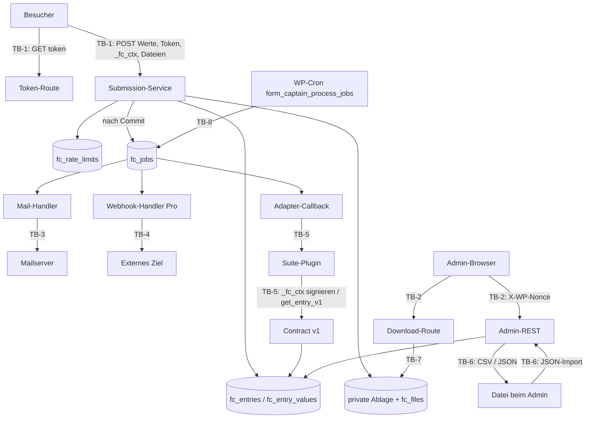

# Datenfluss- und Bedrohungsmodell (P0-10, P0-14)

**Status:** Entwurf zur Freigabe · **Stand:** 16.11.2026 · **Gilt für:** Form Captain Free v1.0, Pro v1, Suite-Adapter (Phase 8)
**Bezug:** konzept.md 4, 5, 6, 7, 10 · TODO P0-10, P0-14, P3-*, P4-*, P5-*, P7-08…P7-18, P8-13…P8-33
**Verwandte Specs:** `datenschutz.md`, `rechtevertrag.md`, `suite-kontext.md`

Methode: STRIDE je Angriffsfläche. Jede Schutzregel hat eine ID `T-<FLÄCHE>-nn`, ist verbindlich (MUSS) und verweist auf den umsetzenden TODO-Task. Tests referenzieren die Regel-ID.

---

## 1. Assets

| ID | Asset | Schutzziel | Ort |
|---|---|---|---|
| A-01 | Feldwerte von Einsendungen (personenbezogen) | Vertraulichkeit, Integrität, Löschbarkeit | `fc_entry_values` |
| A-02 | Entry-Metadaten, Status, Notizen | Integrität, Vertraulichkeit | `fc_entries`, `fc_entry_notes` |
| A-03 | Formularschema + Versionen (inkl. Consent-Text) | Integrität (Nachweis), Verfügbarkeit | `fc_forms`, `fc_form_versions` |
| A-04 | Hochgeladene Dateien (Pro) | Vertraulichkeit, Integrität, Server-Sicherheit | private Ablage, `fc_files` |
| A-05 | Plugin-Secret `form_captain_secret`, Tages-Salt, Webhook-Secrets, Connector-Credentials | Vertraulichkeit | Optionen (autoload=no) / `wp-config.php` |
| A-06 | Outbox-Jobs (Zustellzustand, Idempotenz) | Integrität, Verfügbarkeit | `fc_jobs` |
| A-07 | Benachrichtigungskonfiguration (Empfänger, Reply-To) | Integrität (kein Missbrauch als Relay) | Formularschema |
| A-08 | Admin-Sitzung / Capabilities | Integrität | WordPress |
| A-09 | Server-/Netzwerk-Erreichbarkeit (interne Dienste) | Schutz vor SSRF | Host |
| A-10 | Reputation der Absenderdomain | Verfügbarkeit Mailzustellung | Mailsystem |
| A-11 | Verifizierter Suite-Kontext (Event-/Bestellbezug) | Integrität, Authentizität | `fc_entries` Kontextspalten |

## 2. Akteure

| Akteur | Vertrauen | Fähigkeiten |
|---|---|---|
| Anonymer Besucher / Bot | keines | beliebige HTTP-Requests, Massenrequests, manipulierte Payloads, Dateien |
| Eingeloggter Nutzer ohne Form-Captain-Capability (Abonnent, Autor, Editor) | gering | gültige Cookies + REST-Nonce, Zugriff auf `wp-admin` |
| Form-Captain-Berechtigter (z. B. Rolle mit `form_captain_read_entries`) | eingeschränkt | nur zugewiesene Capabilities |
| Administrator | hoch | alle Capabilities, aber kein Vertrauen in importierte Dateien |
| Andere Plugins (Suite-Adapter, Connectoren) | mittel (gleicher PHP-Prozess) | Aufruf öffentlicher Contract-Funktionen; keine Garantie gegen bösartigen Code |
| Externe Empfänger (Webhook-Ziel, Mailserver) | keines für Antworten | Antworten, Redirects, Verzögerungen |
| Hoster / Backup-System | außerhalb des Modells | Kopien der DB |

## 3. Trust Boundaries

| ID | Grenze | Überquerende Daten |
|---|---|---|
| TB-1 | Internet → öffentliche Routen (`/token`, `/submissions`, `admin-post.php?action=form_captain_submit`) | Token, Feldwerte, `_fc_ctx`, Dateien |
| TB-2 | Browser eingeloggter Nutzer → Admin-REST `/form-captain/v1/admin/...` und Admin-Seiten | Cookies, `X-WP-Nonce`, Formularschemas, Importdateien |
| TB-3 | Form Captain → Mailsystem (`wp_mail`) | Header, Feldwerte (Allowlist) |
| TB-4 | Form Captain → externe HTTP-Ziele (Webhook, Remote-Connector) | gemappte Feldwerte, Signatur |
| TB-5 | Form Captain ↔ andere Plugins im selben Prozess (Contract v1, Adapter-Callbacks, Filter) | IDs, gescopte Werte, Kontext |
| TB-6 | Admin → exportierte Dateien (CSV, Form-JSON) → Tabellenkalkulation/andere Installation | Feldwerte, Schema |
| TB-7 | Dateisystem: private Upload-Ablage ↔ Webserver-Auslieferung | Dateien |
| TB-8 | WP-Cron/Queue (ausgelöst durch beliebige Seitenaufrufe oder System-Cron) | Job-IDs |

## 4. Datenflüsse

Gespeicherte Daten je Fluss: siehe `datenschutz.md` Abschnitt 2.

## 5. STRIDE je Angriffsfläche

Legende: S = Spoofing, T = Tampering, R = Repudiation, I = Information Disclosure, D = Denial of Service, E = Elevation of Privilege.

### 5.1 Öffentliche Submission und Token (TB-1)

| STRIDE | Bedrohung | Schutzregeln |
|---|---|---|
| S | Bot gibt sich als echter Besucher aus; Token wird massenhaft geholt | T-SUB-01, T-SUB-02, T-SUB-06 |
| T | Unbekannte Feld-IDs, Arrays statt Skalare, versteckte bedingte Felder, manipulierte Hidden Fields, falsche Form-Version | T-SUB-03, T-SUB-04, T-SUB-05, T-CTX-* |
| R | Einsender bestreitet Einwilligung | Consent-Nachweis (`datenschutz.md` 5.2), T-SUB-09 |
| I | Fehlermeldungen verraten Interna; Existenz von Entwürfen über `public_id`; Antwort enthält Entry-ID | T-SUB-07, T-SUB-08, T-IDOR-03 |
| D | Requestflut, Riesen-Payload, Spamwelle füllt DB/Queue, Mail-Bombing über Receipt | T-SUB-02, T-SUB-06, T-SUB-10, T-MAIL-05 |
| E | Submission löst privilegierte Aktion aus (Redirect, Adapteraktion mit Browserwerten) | T-RED-*, T-CTX-*, T-SUB-11 |

### 5.2 Admin-Oberfläche und Admin-REST (TB-2)

| STRIDE | Bedrohung | Schutzregeln |
|---|---|---|
| S | CSRF über eingeloggten Admin | T-ADM-01 |
| T | Stored XSS über Formular-Label, HTML-Hinweis, Feldwerte in Entry-Ansicht | T-ADM-03, T-ADM-04 |
| R | Statusänderungen/Löschungen nicht nachvollziehbar | T-ADM-06 |
| I | Editor liest Entries ohne Capability; IDOR | T-ADM-02, T-IDOR-* |
| D | Teure Abfragen/Exporte blockieren Site | T-ADM-05, T-CSV-04 |
| E | Rolle ohne Recht ändert Settings/Capabilities | T-ADM-02, T-ADM-07 |

### 5.3 E-Mail (TB-3)

| STRIDE | Bedrohung | Schutzregeln |
|---|---|---|
| S | Gefälschter Absender über Feldwert im `From` | T-MAIL-02 |
| T | CRLF-Header-Injection (Bcc-Einschleusung) | T-MAIL-01 |
| I | Sensible Felder in Klartext-Mail; Dateien als Anhang | T-MAIL-03, DS-U-06 |
| D | Receipt an Opferadressen (Relay/Mail-Bombing), Reputationsschaden | T-MAIL-05 |
| E | HTML/Links in Mail führen zu Phishing beim Admin | T-MAIL-04 |

### 5.4 CSV-Export (TB-6)

| STRIDE | Bedrohung | Schutzregeln |
|---|---|---|
| T | Formelinjektion (`=HYPERLINK(...)`, DDE) | T-CSV-01 |
| I | Export ohne Recht; Export enthält gelöschte/anonymisierte Daten; Datei bleibt auf Server liegen | T-CSV-02, T-CSV-03, DS-B-05 |
| D | Export großer Datenmengen sprengt Speicher/Laufzeit | T-CSV-04 |
| R | Wer hat wann exportiert | T-CSV-05 |

### 5.5 Formular-JSON-Import/-Export (TB-6)

| STRIDE | Bedrohung | Schutzregeln |
|---|---|---|
| T | Bösartige Datei: XSS im Label, vorangekreuzter Consent, externe Redirects, fremde Empfänger, riesige Schemas, PHP-Objekt-Injection | T-JSON-01…T-JSON-05 |
| I | Export enthält Secrets/Entries | T-JSON-06 |
| E | Import aktiviert sofort Veröffentlichung oder Integrationen | T-JSON-04 |

### 5.6 Upload (Pro, TB-1/TB-7)

| STRIDE | Bedrohung | Schutzregeln |
|---|---|---|
| T | Ausführbare Datei mit harmloser Endung, Polyglot, MIME-Spoofing | T-UPL-01…T-UPL-04 |
| I | Direkter Abruf über erratbare URL, Verzeichnislisting | T-DL-* |
| D | Sehr große Dateien, Dekompressionsbomben, Pixelbomben, viele Dateien | T-UPL-05, T-UPL-06 |
| E | Upload eines PHP-Skripts im Webroot → Codeausführung | T-UPL-02, T-UPL-07, T-DL-01 |

### 5.7 Webhook (Pro, TB-4)

| STRIDE | Bedrohung | Schutzregeln |
|---|---|---|
| S | Empfänger kann Absender nicht verifizieren; Replay beim Empfänger | T-WH-08 |
| T | Redirect auf internes Ziel; DNS-Rebinding | T-WH-01…T-WH-05 |
| I | SSRF auf Metadaten-Dienste (169.254.169.254), interne Admin-Panels; Antwort im Admin angezeigt | T-WH-01…T-WH-06 |
| D | Langsame Ziele blockieren Worker; Riesen-Antwort | T-WH-06, T-JOB-04 |
| R | Unklar, was zugestellt wurde | T-WH-07 |
| E | Secret im Log/Browser | T-WH-09 |

### 5.8 Suite-Adapter und Connectoren (TB-5)

| STRIDE | Bedrohung | Schutzregeln |
|---|---|---|
| S | Gefälschter Event-/Bestellkontext über Hidden Field | T-CTX-01…T-CTX-06 |
| T | Adapter erhält mehr Felder als gemappt; Adapter-Rückgabe manipuliert Entry | T-ADP-01, T-ADP-03 |
| R | Doppelte Gutscheine/Reviews ohne Nachweis | T-ADP-02, T-JOB-02 |
| I | Adapter liest Entries ohne Scope | T-ADP-01, T-IDOR-04 |
| D | Defekter Adapter blockiert Submission | T-ADP-04 |
| E | Inkompatibler Adapter ruft entfernte Funktionen; Adapter setzt Verifiziert-Status aus Nutzerdaten | T-ADP-05, T-CTX-05 |

### 5.9 Cron / Queue (TB-8)

| STRIDE | Bedrohung | Schutzregeln |
|---|---|---|
| S | Beliebiger Aufruf von `wp-cron.php` | T-JOB-01 (Abarbeitung ist idempotent, keine Eingabeparameter) |
| T | Manipulierte Job-Payload (Deserialisierung) | T-JOB-03 |
| R | Zustellung nicht nachvollziehbar | T-JOB-05 |
| I | Feldwerte in `fc_jobs`/`fc_log` | T-JOB-03, DS-06 |
| D | Parallele Worker, hängende Jobs, endlose Retries | T-JOB-02, T-JOB-04 |
| E | Job läuft mit Admin-Rechten eines zufälligen Requests | T-JOB-06 |

## 6. Schutzregeln

### 6.1 Öffentliche Submission (T-SUB)

| ID | Regel | TODO |
|---|---|---|
| T-SUB-01 | Submission verlangt gültiges Submission-Token (HMAC über `form_public_id` + `issued_at` + 16 Byte Zufall, Schlüssel abgeleitet aus Plugin-Secret mit Label `form-captain/submit-token/v1`), Alter ≤ 2 h und ≥ Mindest-Ausfüllzeit (Default 3 s). Token-Route antwortet mit `Cache-Control: no-store, private` und `Vary: *`; kein WordPress-Nonce im öffentlichen Pfad. Fehler: `invalid_token`. | P3-11, P3-14 |
| T-SUB-02 | Rate-Limit je `(form_id, ip_hash)` und je `ip_hash` global sowie für die Token-Route; Defaults in `rechtevertrag.md` 4. Überschreitung: HTTP 429 `rate_limited` mit `Retry-After`. | P3-09 |
| T-SUB-03 | Payload-Normalisierung: Nur Feld-IDs der veröffentlichten Version werden angenommen; unbekannte Schlüssel → `validation_failed` (Code `unknown_field`); Arrays nur für `checkbox`; Strings ohne NUL, gültiges UTF-8; Werte nicht sichtbarer bedingter Felder werden verworfen (nicht gespeichert). | P3-05, P3-07 |
| T-SUB-04 | Serverseitige Validierung unabhängig vom Client; Optionswerte nur aus Schema; Hidden-Feldwerte stammen aus dem Schema-Default, Browserwert wird ignoriert, außer Feld ist explizit als „vom Besucher übergebbar“ markiert (dann gilt er als unverifizierte Nutzereingabe). | P3-05, P8-13 |
| T-SUB-05 | Formular muss `published` sein; `paused` → `form_not_accepting` mit neutraler Meldung; `draft`/`archived`/nicht vorhanden → `form_not_found` (gleiche Antwort, kein Existenz-Orakel). | P2-12, P3-06 |
| T-SUB-06 | Limits laut `budgets.md`: Request-Body Default 64 KB (max. 256 KB, ohne Uploads), ≤ 100 Felder, Feldwert text 190 / textarea 5 000 Zeichen (Default) bzw. Schema-Limit, Payload-Tiefe 2; Überschreitung `payload_too_large` (413) vor dem Parsen des Bodys, soweit möglich anhand `Content-Length`. | P3-17 |
| T-SUB-07 | Öffentliche Fehlerantworten enthalten nur Code, übersetzte Meldung, Feldfehler und `request_id`; keine Exceptions, SQL, Pfade, Provider-Details. | P3-12 |
| T-SUB-08 | Erfolgsantwort enthält keine Entry-ID und keine Werte; nur `success`, `code`, `message`/`redirect_url`, `request_id`. | P3-10, P5-15 |
| T-SUB-09 | Honeypot (Feldname je Formular zufällig, `autocomplete=off`, `tabindex=-1`, visuell versteckt, `aria-hidden`) und Mindestzeit; Treffer werden als `spam` gespeichert **oder** verworfen (Einstellung; Default: als Spam speichern ohne Mails/Jobs). Antwort für Bots identisch mit Erfolg. | P3-08 |
| T-SUB-10 | Spamverdacht (Honeypot, Blockliste) erzeugt keine Jobs (keine Mails, keine Integrationen). | P3-08, P4-07 |
| T-SUB-11 | CORS: keine `Access-Control-Allow-Origin`-Header für öffentliche Routen (Same-Origin); `OPTIONS` antwortet ohne Freigabe. Nur `GET` (Token) bzw. `POST` (Submission) zulässig. | P3-13 |
| T-SUB-12 | Doppelte Requests (Doppelklick, Retry): `fc_entries.request_key = SHA-256(form_id + Token-Nonce)` ist UNIQUE; ein zweiter Request mit demselben Token liefert `duplicate_request` mit derselben Erfolgsantwort ohne neuen Entry. Das Frontend holt nach jedem Erfolg ein neues Token. | P4-03 |

### 6.2 Admin (T-ADM)

| ID | Regel | TODO |
|---|---|---|
| T-ADM-01 | Jede schreibende Admin-Operation: REST mit `X-WP-Nonce` (`wp_rest`) bzw. Admin-Formular mit `check_admin_referer('form_captain_{aktion}')`. GET-Routen ändern nie Zustand. | P2-03, P5-07 |
| T-ADM-02 | `permission_callback` jeder Admin-Route prüft die Capability aus `rechtevertrag.md`; niemals `__return_true`. Menüseiten nutzen dieselbe Capability wie die Daten-Routen. | P2-01, P5-07 |
| T-ADM-03 | Ausgabe aller Feldwerte im Admin escaped (`esc_html`, `esc_attr`, React ohne `dangerouslySetInnerHTML`); Entry-Werte werden nie als HTML interpretiert. | P4-05, P5-08 |
| T-ADM-04 | HTML-Hinweisfelder: `wp_kses` mit fester Allowlist (`p, br, strong, em, a[href,rel,target], ul, ol, li`), beim Speichern **und** bei Ausgabe; `href` nur `http`, `https`, `mailto`. | P2-09 |
| T-ADM-05 | Listen paginiert (max. 100 je Seite), Suche über indizierte Spalten bzw. begrenzte Volltextsuche; alle SQL über `$wpdb->prepare`. | P4-04, P5-08 |
| T-ADM-06 | Statuswechsel, Löschung, Export, Retry, Settings-Änderung erzeugen `fc_log`-Eintrag (user_id, Aktion, Objekt-ID, Zeit) ohne Feldwerte. | P4-06, P1-17 |
| T-ADM-07 | Capability-Zuweisung an Rollen nur mit `form_captain_manage_settings` **und** WordPress `promote_users`; Rolle `administrator` kann `form_captain_manage_settings` nicht verlieren (Aussperrschutz, `rechte.md`). | P5-20 |
| T-ADM-08 | Editor-Speichern mit `schema_revision` (optimistisches Locking); abweichende Revision → `revision_conflict` (409). | P2-13 |

### 6.3 E-Mail (T-MAIL)

| ID | Regel | TODO |
|---|---|---|
| T-MAIL-01 | Alle Headerwerte (To, Reply-To, From-Name, Subject) werden auf `\r`, `\n`, `\0` und `%0a/%0d` geprüft; Treffer → Wert verworfen (Reply-To entfällt, Subject: Zeichen entfernt), Job-Fehlercode `mail_header_rejected` im Log. Subject max. 255 Zeichen. | P4-17 |
| T-MAIL-02 | `From` stammt ausschließlich aus Einstellungen (Default Site-Domain), nie aus Feldwerten. Einsender-Adresse nur als `Reply-To`, nach `is_email` und T-MAIL-01. | P4-07, P2-22 |
| T-MAIL-03 | Mail-Inhalt nur aus explizit gewählten Feldern (Feld-Allowlist je Benachrichtigung); Felder mit Option `sensitive=true` standardmäßig ausgeschlossen. | P4-07 |
| T-MAIL-04 | HTML-Mails: alle Werte `esc_html`, keine automatische Verlinkung von Nutzer-URLs; Klartextteil immer vorhanden. | P4-17 |
| T-MAIL-05 | Receipt an Einsender: max. 1 je Entry; nur an validiertes E-Mail-Feld; Inhalt standardmäßig ohne Feldwerte (Opt-in je Feld); zusätzliches Limit 3 Receipts je Empfängeradresse (HMAC) und Stunde. Kein Receipt bei Spamverdacht. | P4-08 |
| T-MAIL-06 | Empfänger der Admin-Mail sind statisch im Formular konfiguriert; kein Feldwert darf To/Cc/Bcc bestimmen (Routing per Feldwert erst Pro, dort nur auf Admin-definierte Adressliste). | P4-07, P7-10 |

### 6.4 CSV (T-CSV)

| ID | Regel | TODO |
|---|---|---|
| T-CSV-01 | Formelinjektion: Beginnt ein Zellwert (nach Entfernen führender Leerzeichen) mit `=`, `+`, `-`, `@`, `\t` (0x09), `\r` (0x0D), `＝`, `＋`, `－`, `＠`, wird `'` vorangestellt. Ausnahme: Feldtyp `number`, wenn der Wert `^-?\d+(\.\d+)?$` erfüllt. Gilt auch für Kopfzeilen (Labels). | P4-11 |
| T-CSV-02 | Export nur mit `form_captain_export_entries` + Nonce, per `POST`; Datei wird gestreamt (`php://output`), nie im Dateisystem abgelegt. | P4-11 |
| T-CSV-03 | Gelöschte Entries sind nicht enthalten; anonymisierte nur mit Platzhaltern; Status `trash`/`spam` nur, wenn explizit gefiltert. | P5-05 |
| T-CSV-04 | Abfrage in Batches à 500 Entries mit Cursor (`id > last_id`), `set_time_limit` best effort; max. 100 000 Zeilen je Export, sonst Hinweis auf Datumsfilter. | P4-11, P6-05 |
| T-CSV-05 | `fc_log` mit `export_created` (user_id, Formular-ID, Filter, Zeilenzahl). | P4-11 |
| T-CSV-06 | Format: UTF-8 mit BOM (abschaltbar), RFC 4180, Trennzeichen `,` (Option `;`), Zeilenende CRLF, Felder mit Trennzeichen/Quote/Zeilenumbruch in `"` mit verdoppelten Quotes. Dateiname `form-captain-{form-slug}-{Y-m-d}.csv`, Header `Content-Disposition: attachment`, `X-Content-Type-Options: nosniff`. | P4-11 |

### 6.5 JSON-Import/-Export (T-JSON)

| ID | Regel | TODO |
|---|---|---|
| T-JSON-01 | Import: Datei ≤ 1 MB, `json_decode` mit Tiefe 32, niemals `unserialize`; Validierung gegen JSON-Formularschema (`formularschema.md`) vor jeder Speicherung; Fehler `schema_invalid` bzw. `schema_unsupported` mit Pfadangabe. | P4-12 |
| T-JSON-02 | Alle Texte durchlaufen dieselbe Sanitizing-Pipeline wie der Editor (T-ADM-04); Consent `default` → Ablehnung (DS-C-01). | P4-12, P2-09 |
| T-JSON-03 | Redirect-Ziele werden nach T-RED neu validiert; ungültige → entfernt + Hinweis im Importbericht. | P4-12, P3-15 |
| T-JSON-04 | Import erzeugt immer ein neues Formular im Status `draft` mit neuer `public_id` und neuen internen IDs; Feld-IDs bleiben stabil. Integrationsaktionen werden deaktiviert importiert. Importbericht listet Empfängeradressen zur Prüfung. | P4-12 |
| T-JSON-05 | Limits wie Editor (`budgets.md`): ≤ 100 Felder, ≤ 200 Optionen je Feld, Schema-JSON ≤ 256 KB. | P3-17 |
| T-JSON-06 | Export enthält nur Schema und Formulareinstellungen; ausgeschlossen: Entries, Dateien, Webhook-Secrets, Connector-Credentials, `public_id`, interne IDs, Benutzer-IDs. | P4-12 |

### 6.6 Upload (T-UPL, Pro)

| ID | Regel | TODO |
|---|---|---|
| T-UPL-01 | Allowlist je Feld aus fester Tabelle Endung ↔ MIME (z. B. `pdf`↔`application/pdf`, `jpg/jpeg`↔`image/jpeg`, `png`↔`image/png`, `webp`↔`image/webp`, `txt`↔`text/plain`, `docx`↔`application/vnd.openxmlformats-officedocument.wordprocessingml.document`). Datei wird nur angenommen, wenn Endung **und** per `finfo` (Magic Bytes) ermittelter MIME übereinstimmen (`wp_check_filetype_and_ext` + eigene Prüfung). | P7-08, P7-15 |
| T-UPL-02 | Immer verboten, auch wenn Admin es einträgt: `php*`, `phtml`, `phar`, `cgi`, `pl`, `py`, `sh`, `exe`, `dll`, `js`, `mjs`, `html`, `htm`, `xhtml`, `svg`, `svgz`, `xml`, `swf`, `jar`, `hta`, `bat`, `cmd`, `com`, `msi`, `htaccess`, `user.ini`; doppelte Endungen (`a.php.jpg`) werden anhand aller Segmente geprüft. | P7-08 |
| T-UPL-03 | MIME-Spoofing: Der vom Client gesendete `Content-Type` wird ignoriert. Bilder zusätzlich mit `getimagesize`; bei Abweichung `rejected`. Polyglot-Schutz: Bilder werden optional neu kodiert (Einstellung, Default an), Ursprungsdatei verworfen. | P7-15 |
| T-UPL-04 | Gespeicherter Name (`fc_files.storage_key`): 32 Hex-Zeichen, keine Endung; Originalname nur in `fc_files.original_name` (sanitize_file_name, max. 255 Zeichen), nie im Dateisystem. | P7-08 |
| T-UPL-05 | Größen: Default 5 MB je Datei, 20 MB je Submission, max. 5 Dateien je Feld; Limit ≤ `upload_max_filesize`. Prüfung vor dem Verschieben; Überschreitung `payload_too_large`. | P7-08 |
| T-UPL-06 | Komprimierte/expandierende Formate: `zip`, `gz`, `7z`, `rar`, `tar` standardmäßig nicht erlaubt; werden sie freigeschaltet, wird nie serverseitig entpackt. Bilder: Pixelzahl ≤ 40 MP (aus Header, vor Dekodierung) – sonst `rejected`. Office-Dateien (`docx`) nicht entpackt/geparst. PDFs werden nicht gerendert. | P7-15 |
| T-UPL-07 | Status-Pipeline `quarantine` → Prüfungen T-UPL-01…06 → optionaler Scanner-Filter `form_captain_scan_file_v1` (Rückgabe `clean`/`rejected`/`error`) → `clean`. Nur `clean` ist abrufbar; `error` bleibt in Quarantäne mit Admin-Hinweis. | P7-15 |
| T-UPL-08 | Upload erfolgt im selben Submission-Request (multipart) nach Token-/Rate-Limit-Prüfung; kein separater öffentlicher Upload-Endpunkt ohne Token. | P7-08 |

### 6.7 Downloads (T-DL)

| ID | Regel | TODO |
|---|---|---|
| T-DL-01 | Private Ablage enthält `index.php` (leer) und `.htaccess` (`Require all denied` + `Deny from all`); Systemstatus prüft per Loopback-HTTP-Request auf eine Testdatei, ob sie öffentlich abrufbar ist, und zeigt sonst eine rote Warnung mit Nginx-Snippet. Uploads werden deaktiviert, solange der Test fehlschlägt (Override per Konstante). | P7-08, P7-16 |
| T-DL-02 | Abruf ausschließlich über `GET /form-captain/v1/admin/files/{file_id}/download` mit Login, `form_captain_read_entries` und `_wpnonce`; Route nutzt `fc_files.id`; Zugriff nur nach Capability-Prüfung, zusätzlich `file.entry_id` existiert und `status = clean`. | P7-16 |
| T-DL-03 | Antwort-Header: `Content-Type` = validierter MIME, `Content-Disposition: attachment; filename*=UTF-8''…`, `X-Content-Type-Options: nosniff`, `Content-Security-Policy: sandbox`, `Cache-Control: private, no-store`. | P7-16 |
| T-DL-04 | Es gibt keine öffentlichen, nicht authentisierten Download-Links in v1 (auch nicht in Mails). | P7-16, DS-U-06 |
| T-DL-05 | Pfadauflösung nur über `fc_files.storage_key` relativ zur Basis; `realpath`-Prüfung, dass das Ziel innerhalb der Basis liegt; keine Pfadbestandteile aus Requests. | P7-16 |

### 6.8 Webhook (T-WH, Pro)

| ID | Regel | TODO |
|---|---|---|
| T-WH-01 | URL-Validierung beim Speichern **und** vor jeder Zustellung: Schema `https` (`http` nur bei Konstante `FORM_CAPTAIN_ALLOW_HTTP_WEBHOOKS`), Port 443/80 oder explizit erlaubte Ports aus Einstellung, keine Userinfo (`user:pass@`), Host als DNS-Name (IP-Literale nur, wenn öffentlich und Admin bestätigt), IDN in Punycode. | P7-14 |
| T-WH-02 | DNS-Auflösung aller A/AAAA-Records; Ablehnung, wenn **eine** Adresse in einem gesperrten Netz liegt: IPv4 `0.0.0.0/8`, `10.0.0.0/8`, `100.64.0.0/10`, `127.0.0.0/8`, `169.254.0.0/16`, `172.16.0.0/12`, `192.0.0.0/24`, `192.0.2.0/24`, `192.168.0.0/16`, `198.18.0.0/15`, `198.51.100.0/24`, `203.0.113.0/24`, `224.0.0.0/4`, `240.0.0.0/4`; IPv6 `::/128`, `::1/128`, `::ffff:0:0/96` (gemappte IPv4 nach IPv4-Regel), `64:ff9b::/96`, `fc00::/7`, `fe80::/10`, `ff00::/8`, `2001:db8::/32`. Fehler `webhook_target_forbidden` (definitiv, kein Retry). | P7-14 |
| T-WH-03 | DNS-Rebinding: Verbindung wird auf die geprüfte IP gepinnt (`CURLOPT_RESOLVE` über `http_api_curl`, Host-Header/SNI bleibt Hostname). Ohne cURL-Transport → Zustellung verweigert (`webhook_transport_unsupported`). | P7-14 |
| T-WH-04 | Redirects werden nicht verfolgt (`redirection => 0`). 3xx gilt als definitiver Fehler `webhook_redirect_not_followed`, Ziel-URL der Weiterleitung wird nur gekürzt (Host) protokolliert. | P7-14 |
| T-WH-05 | Zusätzlich `wp_safe_remote_post` (`reject_unsafe_urls`) als zweite Linie; eigene Prüfung ist maßgeblich. Filter `http_request_host_is_external` wird nicht verändert. | P7-14 |
| T-WH-06 | Timeout gesamt 10 s, Verbindung 5 s; Antwortgröße max. 64 KB (`limit_response_size`); nur Statuscode + max. 1 KB Antwortauszug (escaped) wird gespeichert/angezeigt. | P7-14 |
| T-WH-07 | Jede Zustellung protokolliert Job-ID, Ziel-Host, Statuscode, Dauer, Versuch, Idempotenzschlüssel – keine Payload-Werte. | P7-11 |
| T-WH-08 | Signatur: Header `X-Form-Captain-Signature: t={unix},v1={hex(HMAC-SHA256(secret, t + "." + body))}`, `X-Form-Captain-Idempotency-Key`, `X-Form-Captain-Delivery-Id`; Empfänger soll Zeitfenster 5 min prüfen. Zwei Secrets gleichzeitig während Rotation (`v1=` zweimal). | P7-11, P7-17 |
| T-WH-09 | Webhook-Secrets: ≥ 32 Byte zufällig, autoload=no, im Admin nur einmalig nach Erzeugung sichtbar, danach maskiert; nie in Log, Export, Systemstatus, JS. | P5-16, P8-33 |

### 6.9 Suite-Kontext (T-CTX)

| ID | Regel | TODO |
|---|---|---|
| T-CTX-01 | Event-, Bestell-, Kurs- oder sonstige Referenzen gelten nur als vertrauenswürdig, wenn sie aus einem gültigen `_fc_ctx` stammen (`suite-kontext.md`). Hidden Fields, URL-Parameter, Cookies und Referrer sind nie Vertrauensnachweis. | P0-15, P8-13 |
| T-CTX-02 | Signaturprüfung in konstanter Zeit (`hash_equals`) **vor** JSON-Dekodierung. | P8-13 |
| T-CTX-03 | Kontext ist zweckgebunden (`purpose`) und formulargebunden (`form_id`); Abweichung → Ablehnung. | P8-13, P8-14 |
| T-CTX-04 | Einweg-Zwecke: Nonce wird atomar bei Entry-Commit verbraucht; Wiederverwendung → `context_replayed`. | P8-13, P8-14 |
| T-CTX-05 | Verifizierungsstatus („kaufbestätigt“, „teilnahmebestätigt“) darf nur aus einem gültigen Kontext eines Zwecks mit Resolver-Bestätigung stammen; Adapter darf ihn nicht aus Feldwerten ableiten. | P8-08, P8-13 |
| T-CTX-06 | Öffentlich nur drei Codes: `context_expired`, `context_replayed`, sonst einheitlich `invalid_context`; Detailcode nur in `fc_log`. | P8-14 |

### 6.10 Adapter/Connectoren (T-ADP)

| ID | Regel | TODO |
|---|---|---|
| T-ADP-01 | Callback erhält nur gemappte, validierte Felder + `form_id`, `entry_id`, `idempotency_key`; Scopes für `form_captain_get_entry_v1` sind auf das Mapping begrenzt (`rechtevertrag.md`). Felder mit `sensitive=true` nur nach separater Freigabe. | P8-28 |
| T-ADP-02 | Idempotenzschlüssel `form-captain:{site_id}:{entry_id}:{action_key}:{action_instance_id}` (`api-v1.md`), UNIQUE in `fc_jobs.idempotency_key`. | P8-29 |
| T-ADP-03 | Rückgabewert des Callbacks wird gegen Ergebnis-Schema validiert (`status` ∈ `success`/`retry`/`fail`, `code`, `message` ≤ 255, `remote_id` ≤ 191 Zeichen); ungültige Rückgabe = `retry` mit Code `invalid_result`; er kann Entry-Werte nicht ändern. | P8-24 |
| T-ADP-04 | Callback läuft nur im Worker, nie im Submission-Request; Exceptions werden gefangen → `retry` mit Code `exception` (Status `failed`, nach Maximalversuchen `dead`). | P8-30 |
| T-ADP-05 | Major-Version-Prüfung bei Registrierung; inkompatibel → Adapter deaktiviert, Code `incompatible_contract`. | P8-02, P8-15 |
| T-ADP-06 | Neue Connectoren sind deaktiviert; Aktivierung/Konfiguration/Testlauf nur mit `form_captain_manage_integrations` + Nonce. Testlauf verwendet Flag `test_mode=true` im Aufruf; Connector muss reale Nebenwirkungen unterlassen (Vertragspflicht, nicht technisch erzwingbar). | P8-26, P8-33 |

### 6.11 Cron/Queue (T-JOB)

| ID | Regel | TODO |
|---|---|---|
| T-JOB-01 | `form_captain_process_jobs` nimmt keine Request-Parameter; Aufruf durch Dritte bewirkt nur reguläre Abarbeitung. | P4-14 |
| T-JOB-02 | Claim: `UPDATE fc_jobs SET status='running', lock_token=%s, locked_until_gmt=UTC_TIMESTAMP()+INTERVAL 5 MINUTE, attempts=attempts+1 WHERE status IN ('pending','failed') AND run_after_gmt<=UTC_TIMESTAMP() AND (locked_until_gmt IS NULL OR locked_until_gmt<UTC_TIMESTAMP()) ORDER BY run_after_gmt, id LIMIT 20`; danach nur Zeilen mit eigenem `lock_token` verarbeiten. Abgelaufene Locks werden als `failed`/`lock_expired` zurückgesetzt (`zustaende.md`). | P4-14, P4-15 |
| T-JOB-03 | `payload` ist JSON mit IDs und Konfigurationsreferenzen, kein serialisiertes PHP, keine Feldwerte. Handler lädt Entry frisch; fehlt er → `cancelled` (`entry_gone`). | P4-14, P4-18 |
| T-JOB-04 | Batch max. 20 Jobs bzw. 20 s je Lauf (`budgets.md`); Backoff und Maximalversuche (8 → `dead`) laut `zustaende.md`. | P4-14, P8-30 |
| T-JOB-05 | Jeder Versuch schreibt `last_error_code`, `last_attempt_at`; Admin-Retry setzt `attempts=0`, `status=pending` und loggt den Benutzer. | P4-09 |
| T-JOB-06 | Worker setzt `wp_set_current_user(0)` vor jedem Job; Handler dürfen sich nicht auf Capabilities eines zufällig auslösenden Requests verlassen. | P4-14 |

### 6.12 Open Redirect (T-RED)

| ID | Regel | TODO |
|---|---|---|
| T-RED-01 | Redirect-Ziel nach Submission wird im Formular gespeichert als `page_id` (veröffentlichte Seite) oder als URL, deren Host gleich `home_url()`-Host ist. Externe Hosts in v1 nicht zulässig. | P3-15 |
| T-RED-02 | Die Submission (Body, Query, Header) kann das Ziel nicht beeinflussen; Platzhalter/Feldwerte in Redirect-URLs sind nicht erlaubt. | P3-15 |
| T-RED-03 | Ausgabe über `wp_validate_redirect($url, home_url('/'))`; No-JS-Pfad nutzt `wp_safe_redirect`. Seite gelöscht/unveröffentlicht → Fallback auf Erfolgsmeldung. | P3-15 |
| T-RED-04 | `_wp_http_referer`/Rücksprung im No-JS-Fehlerfall nur auf die Quellseite, validiert mit `wp_validate_redirect`. | P3-10, P3-15 |

### 6.13 IDOR (T-IDOR)

| ID | Regel | TODO |
|---|---|---|
| T-IDOR-01 | Jede Admin-Route lädt das Objekt per ID und prüft danach Capability; existiert es nicht → `not_found` (404); fehlt Capability → `forbidden` (403) unabhängig von der Existenz (Capability-Check zuerst). | P5-15 |
| T-IDOR-02 | Verschachtelte Routen prüfen Zugehörigkeit (`entry.form_id == {form_id}`, `note.entry_id == {entry_id}`, `file.entry_id == {entry_id}`). | P5-15 |
| T-IDOR-03 | Öffentliche Routen verwenden ausschließlich `public_id` (16 Zeichen `[a-z0-9]` aus CSPRNG, ≈ 82 Bit; `datenmodell.md`); numerische IDs werden öffentlich nie ausgegeben oder angenommen. | P3-06 |
| T-IDOR-04 | `form_captain_get_entry_v1` gibt ohne Capability bzw. ohne aktiven Job-Grant für genau diese `entry_id` `forbidden` zurück. | P8-01 |
| T-IDOR-05 | Bulk-Aktionen validieren jede ID einzeln; nicht erlaubte/nicht existente IDs werden übersprungen und gemeldet. | P4-06 |

## 7. Restrisiken

| ID | Restrisiko | Umgang |
|---|---|---|
| R-01 | Bösartiges Plugin im selben PHP-Prozess kann alle Schutzmaßnahmen umgehen. | Außerhalb des Modells; Doku-Hinweis. |
| R-02 | Nginx ohne Deny-Regel macht private Ablage öffentlich. | T-DL-01 Selbsttest + Upload-Sperre. |
| R-03 | Mail-Zustellung über `wp_mail` ohne SMTP unzuverlässig. | Systemstatus, Testversand (P2-22). |
| R-04 | Backups enthalten gelöschte Daten. | `datenschutz.md` 7. |
| R-05 | Webhook-Ziel, das selbst intern weiterleitet (Server-seitig beim Empfänger). | Nicht kontrollierbar; Doku. |
| R-06 | Ohne Malware-Scanner bleiben schädliche, aber formal gültige Dateien (z. B. Makro-docx) möglich. | Default-Allowlist ohne Office-Formate; Scanner-Hook; Doku. |
