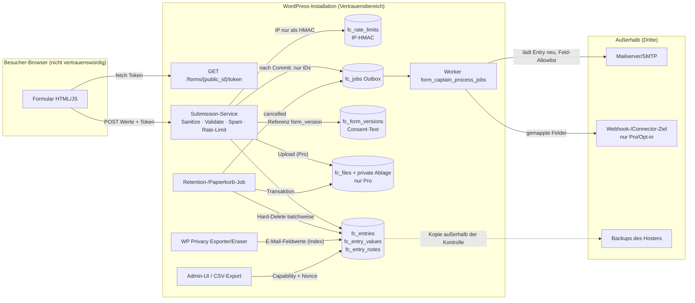

# Spezifikation Datenschutz (P0-08)

**Status:** Entwurf zur Freigabe · **Stand:** 16.11.2026 · **Gilt für:** Form Captain Free v1.0, Upload-Teil für Form Captain Pro v1
**Bezug:** konzept.md 1.1, 4, 4.1, 6.1, 7, 10 · TODO P0-08, P4-13, P4-18, P5-01…P5-06, P5-13, P5-14, P5-17, P5-18, P7-09, P7-16
**Verwandte Specs:** `bedrohungsmodell.md`, `rechtevertrag.md`, `suite-kontext.md`, Datenmodell (P0-04), Zustandsmodelle (P0-06)

> Diese Spezifikation ist eine technische Umsetzungsvorgabe, keine Rechtsberatung. Punkte, die eine rechtliche Bewertung brauchen, stehen in Abschnitt 13.

---

## 1. Grundsätze

| ID | Regel |
|---|---|
| DS-01 | Alle Einsendungen bleiben in der eigenen WordPress-Datenbank. Kein Datenversand an Dritte im Free-Kern, außer über ausdrücklich vom Administrator aktivierte Integrationen/Captcha-Anbieter. |
| DS-02 | Datenminimierung: Es werden nur Feldwerte, Formular-/Versionsbezug, Status, UTC-Zeitstempel, optional `user_id` (eingeloggter Nutzer) und minimale Quellenmetadaten (Quell-URL ohne Query-String, Quelle `rest`/`admin_post`/`contract`) gespeichert. |
| DS-03 | Keine rohe IP-Adresse wird gespeichert – weder in `fc_entries`, `fc_rate_limits`, `fc_log` noch in Optionen. Für Rate-Limits wird ausschließlich `HMAC-SHA256(ip, site_secret ‖ tagessalt)` verwendet (Abschnitt 9). |
| DS-04 | Kein User-Agent, kein Referrer mit Query-String, kein Browser-Fingerprint, keine Geolokalisierung. |
| DS-05 | Alle Zeitstempel in UTC (`DATETIME`, Format `Y-m-d H:i:s`, UTC). Darstellung im Admin in der WordPress-Zeitzone. |
| DS-06 | Feldwerte werden nie in `fc_log`, PHP-Error-Log, Debug-Ausgaben, Systemstatus oder `fc_jobs.payload` kopiert. Jobs referenzieren nur IDs (`entry_id`, `form_id`, Aktionsschlüssel). |
| DS-07 | Löschung ist endgültig: Hard-Delete von `fc_entries`, `fc_entry_values`, `fc_entry_notes`, zugehörigen `fc_files` (inkl. physischer Dateien) und Abbruch offener `fc_jobs` (Status `cancelled`). |

## 2. Gespeicherte personenbezogene Daten (Inventar)

| Speicherort | Inhalt | Personenbezug | Löschung durch |
|---|---|---|---|
| `fc_entries` | Form-ID, `form_version_id`, Status, `created_gmt`, `trashed_gmt`, `expires_gmt`, `user_id` (optional), `source_url`, `context_json` (verifizierter Suite-Kontext), `consent_json`, Anonymisierungsmarker | indirekt | Retention, Papierkorb, Eraser, manuell, Uninstall |
| `fc_entry_values` | Feldwerte je `entry_id` + `field_id`; E-Mail-Werte normalisiert (trim, lowercase) für die Privacy-Suche über Index `field_value` | direkt | wie `fc_entries` (abhängig) |
| `fc_entry_notes` | interne Notizen, Autor-`user_id`, Zeit | möglich | mit Entry |
| `fc_files` (Pro) | `storage_key`, `original_name`, MIME, Größe, SHA-256, Status, `expires_gmt` | direkt | mit Entry oder Upload-Ablauf |
| `fc_jobs` | Jobtyp, IDs, Status, Fehlercode, Idempotenzschlüssel | nein (nur IDs) | `succeeded` nach 30 Tagen, `dead` nach 90 Tagen (zustaende.md); bei Entry-Löschung `cancelled` |
| `fc_rate_limits` | IP-HMAC-Bucket, Zähler, Ablauf | pseudonym, nach 24 h nicht mehr zuordenbar | automatisch nach `expires_at` |
| `fc_log` | Korrelations-ID, Code, Zeit, Objekt-IDs | nein | 30 Tage rollierend |
| `fc_form_versions` | Schema-Snapshot inkl. Consent-Text | nein | mit Formular (nur wenn keine Entries mehr referenzieren) |
| WP-Mail (Transport) | Admin-Mail/Receipt mit freigegebenen Feldwerten | direkt | außerhalb von Form Captain (Postfach/SMTP) |

> Spaltennamen folgen `datenmodell.md` (P0-04). Zusätzlich benötigt diese Spec: (a) einen Anonymisierungsmarker an `fc_entries` (Vorschlag `anonymized_gmt DATETIME NULL`) und (b) dass `trashed_gmt` auch beim Wechsel nach `spam` gesetzt wird (Semantik „Eintritt in die 30-Tage-Löschfrist“). Beides ist in `datenmodell.md` nachzutragen.

## 3. Datenflussdiagramm



## 4. Aufbewahrung (Retention)

### 4.1 Optionen

| Wert (`retention_mode`) | Label EN (Quelltext) | Label DE | Wirkung |
|---|---|---|---|
| `days_90` | 90 days | 90 Tage | `expires_gmt = created_gmt + 90 × 86 400 s` |
| `months_12` | 12 months (recommended) | 12 Monate (empfohlen) | `expires_gmt = created_gmt + P12M` (Kalendermonate) |
| `manual` | Keep until deleted manually | Bis zur manuellen Löschung behalten | `expires_gmt = NULL`, keine automatische Löschung |

- **Global:** Option `form_captain_settings[retention_mode]`, Default bei Neuinstallation `months_12`. Auswahl im Installationsassistenten (Schritt 5) und unter *Einstellungen → Datenschutz & Speicherung*.
- **Je Formular:** Formular-Einstellung `retention_mode` mit zusätzlichem Wert `inherit` (Default). `inherit` folgt der globalen Option zum Zeitpunkt der Berechnung.
- Keine weiteren Werte in v1 (kein Freitext-Zeitraum).

### 4.2 Ablaufberechnung

1. Basis ist immer `fc_entries.created_gmt` (UTC), nie Statuswechsel oder letzte Bearbeitung.
2. Berechnung in PHP mit `DateTimeImmutable('…', new DateTimeZone('UTC'))`:
   - `days_90`: `->add(new DateInterval('P90D'))`
   - `months_12`: `->add(new DateInterval('P12M'))`. Sonderfall 29.02.: PHP ergibt 01.03. des Folgejahres – so akzeptiert und getestet.
3. `expires_gmt` wird beim Speichern des Entries gesetzt und bei jeder Änderung des wirksamen Modus (global oder Formular) für alle betroffenen Entries neu berechnet (Job `cleanup.retention` mit Modus `recalculate`, 500 Entries je Lauf).
4. **Schonfrist bei Verkürzung:** Ergibt die Neuberechnung `expires_gmt < now + 14 Tage`, wird `expires_gmt = now + 14 Tage` gesetzt. Dadurch wird nach einer Einstellungsänderung niemals sofort gelöscht, und der Admin-Hinweis (4.3) ist mindestens 14 Tage sichtbar.
5. Wechsel auf `manual` setzt `expires_gmt = NULL`. Wechsel von `manual` auf eine Frist berechnet ab `created_gmt` (mit Schonfrist nach Regel 4).
6. Status `archived` und `read` ändern nichts an der Frist. `trash` und `spam` unterliegen zusätzlich der Papierkorbregel (4.4); maßgeblich ist der frühere Zeitpunkt.

### 4.3 Admin-Hinweise vor Löschung

| Stelle | Bedingung | Verhalten |
|---|---|---|
| Dashboard-Hinweis (nicht wegklickbar solange zutreffend, aber einklappbar) | Entries mit `expires_gmt` in ≤ 14 Tagen vorhanden | Text DS-T-10 mit Anzahl und frühestem Datum; Link auf gefilterte Entry-Liste |
| Entry-Liste | Filter „Läuft bald ab“ | Spalte/Badge „Löschung am {Datum}“ für Entries ≤ 14 Tage |
| Entry-Detail | immer, sofern `expires_gmt` gesetzt | DS-T-11 „Wird automatisch gelöscht am …“ |
| Einstellungsänderung Retention (global oder Formular) | vor dem Speichern | Modal mit Vorschau DS-T-05: Anzahl betroffener Entries je Formular, frühestes Löschdatum; Speichern nur nach Bestätigung |
| Systemstatus | immer | letzter Bereinigungslauf, Anzahl gelöschter Entries (Zahl, keine Inhalte), nächster Lauf |

Ein Hinweis wird nur Nutzern mit `form_captain_read_entries` angezeigt.

### 4.4 Papierkorb und Spam

- Status `trash`: endgültige Löschung 30 Tage nach `trashed_gmt` (UTC). Wiederherstellung innerhalb der 30 Tage stellt den vorherigen Status wieder her (`previous_status`).
- Status `spam`: identisch 30 Tage nach `trashed_gmt` (wird beim Wechsel nach `spam` gesetzt; Festlegung dieser Spec, siehe 13). Spam wird nie per Retention-Vorschau angekündigt.
- Manuelles „Endgültig löschen“ ist jederzeit möglich (Capability `form_captain_delete_entries`).

### 4.5 Bereinigungsjob

- Cron-Event `form_captain_daily_cleanup` (täglich, Uhrzeit zufällig bei Aktivierung gewählt) legt Job `cleanup.retention` in `fc_jobs` an (Idempotenzschlüssel `cleanup.retention:{Y-m-d}`); die Ausführung erfolgt über `form_captain_process_jobs`.
- Batch: max. 200 Entries je Durchlauf, max. 20 s Laufzeit; danach erneutes Einplanen, bis nichts mehr fällig ist.
- Auswahl: `expires_gmt <= UTC_NOW()` ODER (`status IN ('trash','spam')` UND `trashed_gmt <= UTC_NOW() - 30 Tage`).
- Reihenfolge je Entry: (1) offene Jobs des Entries auf `cancelled` setzen, (2) Dateien löschen (über Filter `form_captain_delete_entry_files_v1`; Kern löscht auch ohne aktives Pro), (3) `fc_entry_notes`, `fc_entry_values`, `fc_entries` in einer Transaktion löschen, (4) Action `form_captain_entry_deleted_v1` mit `reason = retention` (gilt auch für abgelaufenen Papierkorb/Spam), (5) `fc_log` mit Code `entry_purged` und Entry-ID.
- Fehler bei einem Entry stoppen den Batch nicht; der Entry bleibt fällig und wird beim nächsten Lauf erneut versucht. Nach 3 Fehlschlägen erscheint ein Systemstatus-Hinweis.
- Laufende Jobs (`running`) eines zu löschenden Entries: Entry wird trotzdem gelöscht; jeder Job-Handler lädt den Entry unmittelbar vor der Zustellung neu und beendet sich mit `cancelled`/`entry_gone`, wenn er fehlt (P4-18).

## 5. Einwilligungsfeld (Consent)

### 5.1 Regeln

| ID | Regel |
|---|---|
| DS-C-01 | Feldtyp `consent` wird als einzelne Checkbox gerendert, **niemals** mit `checked`. Das Schema hat für `consent` keine Eigenschaft `default`; der Schema-Validator weist ein solches Attribut mit `schema_invalid` zurück (auch beim JSON-Import). |
| DS-C-02 | Weder Standardwert, versteckter Wert, URL-Parameter, Suite-Kontext noch Vorausfüllung eingeloggter Nutzer dürfen ein Consent-Feld setzen. |
| DS-C-03 | `consent_text` (`formularschema.md`): begrenztes HTML (`a[href|target|rel]`, `strong`, `em`); Links auf die Datenschutzseite über Platzhalter `{privacy_policy_url}` (aus `get_privacy_policy_url()`). |
| DS-C-04 | Ist das Consent-Feld `required`, wird die Einsendung ohne Häkchen mit `validation_failed` (Feldfehler `consent_required`) abgelehnt. Optionale Consent-Felder speichern `given=false`. |
| DS-C-05 | Jede Änderung an `consent_text` erhöht `consent_revision` (Integer ≥ 1) des Feldes im Schema. Der Editor erhöht automatisch, der Import übernimmt den Wert nicht, sondern setzt 1. |
| DS-C-06 | Veröffentlichte Schemas liegen unveränderlich in `fc_form_versions`; damit ist der exakte Wortlaut jeder Revision nachweisbar. |
| DS-C-07 | Consent-Felder werden standardmäßig in Admin-Mails als „Ja/Nein“ ausgegeben, nie als Hash. |

### 5.2 Gespeicherter Nachweis

`fc_entry_values.value` des Consent-Feldes ist `"1"` bzw. `"0"`. Der Nachweis steht in `fc_entries.consent_json` als Objekt je Consent-Feld-ID (JSON, UTF-8):

```json
{ "f_consent": {
  "given": true,
  "text_hash": "sha256:9b1c…(64 hex)",
  "revision": 3,
  "form_version": 7,
  "given_at": "2026-11-16T09:41:07Z"
} }
```

- `text_hash` = `hash('sha256', N(consent_text))` mit N = `wp_strip_all_tags` nach Platzhalter-Ersetzung → Whitespace-Folgen zu einem Leerzeichen → `trim` → Unicode NFC (falls `Normalizer` verfügbar, sonst unverändert; Systemstatus meldet fehlendes `intl`).
- `given_at` = `fc_entries.created_gmt` (Serverzeit UTC, ISO 8601), nicht Clientzeit.
- `form_version` = `version_no` aus `fc_form_versions` (zu `fc_entries.form_version_id`), gegen die validiert wurde.
- Anzeige im Entry-Detail: „Einwilligung erteilt am {Datum}, Text-Revision {n}“ + Link „Wortlaut anzeigen“ (öffnet Snapshot-Text).
- Anonymisierung (6.3) behält den Consent-Nachweis (enthält keinen Personenbezug außer über den Entry).

## 6. WordPress Privacy Exporter / Eraser

### 6.1 Registrierung

- Filter `wp_privacy_personal_data_exporters`, Schlüssel `form-captain`, Label „Form Captain – Formular-Einsendungen“.
- Filter `wp_privacy_personal_data_erasers`, Schlüssel `form-captain`, gleiches Label.
- Pagination: 50 Entries je Seite (`$page` 1-basiert), stabile Sortierung `id ASC`.

### 6.2 Zuordnung einer Person

Eine Anfrage-E-Mail `$email` wird normalisiert: `trim`, `strtolower` (gesamte Adresse), Validierung mit `is_email`. Ungültig → leeres Ergebnis, `done = true`.

Ein Entry gehört zur Anfrage, wenn **mindestens eine** Bedingung zutrifft:

1. Ein Wert eines Feldes vom Typ `email`, dessen Feldoption `privacy_lookup` = `true` ist (Default für `email`-Felder `true`, im Editor abschaltbar für z. B. „E-Mail des Beschenkten“), ist nach Normalisierung gleich `$email`. Technisch: E-Mail-Werte werden beim Speichern normalisiert (trim, lowercase) abgelegt; Abfrage `field_id IN (…lookup-Felder…) AND value = %s` über Index `field_value (field_id, value(64))`; kein `LIKE` über Volltext.
2. `fc_entries.user_id` = ID des WordPress-Benutzers mit dieser E-Mail (`get_user_by('email')`).

Keine unscharfe Zuordnung (Namen, Telefon, Freitext). Freitextfelder, die die Adresse zufällig enthalten, werden nicht gesucht.

### 6.3 Exporter

- `group_id`: `form-captain-entries`, `group_label`: „Formular-Einsendungen“ (EN: *Form submissions*), `group_description`: DS-T-20.
- `item_id`: `form-captain-entry-{entry_id}`.
- `data`: `Formular` (Formularname aus Snapshot), `Eingegangen am` (UTC → Site-Zeitzone), `Status`, dann je Feld `Label` aus `fc_form_versions` der Entry-Version → Wert als Text (Auswahl: Optionslabel; Consent: „Erteilt am …, Revision n“ / „Nicht erteilt“; Datei (Pro): Originaldateiname + Hinweis „Datei auf Anfrage“).
- Nicht exportiert: interne Notizen, Rate-Limit-Daten, Job-Status, Hashes (siehe offener Punkt 13.3).
- Entries im Status `trash` und `spam` werden mit exportiert (sie sind noch gespeichert).

### 6.4 Eraser

Einstellung `form_captain_settings[privacy_erasure_mode]`: `delete` (Default) oder `anonymize`.

| Modus | Wirkung je zugeordnetem Entry | Rückgabe |
|---|---|---|
| `delete` | Wie Bereinigungsjob 4.5 Schritte 1–5, `reason = erasure` | `items_removed = true` |
| `anonymize` | Werte aller Felder der Typen `text`, `textarea`, `email`, `phone`, `hidden`, `date`, `number` werden durch `[deleted]` (bzw. NULL bei Zahl/Datum) ersetzt; `user_id` = NULL; `source_url` = NULL; Notizen gelöscht; Dateien gelöscht; Auswahl-/Checkbox-/Optionswerte bleiben (für Statistik), Consent-Nachweis bleibt; Anonymisierungsmarker = now; offene Jobs `cancelled`; Action `form_captain_entry_deleted_v1` mit `reason = erasure` (personenbezogene Daten sind gelöscht; Adapter bereinigen wie bei Löschung) | `items_removed = true`, Nachricht DS-T-22 |

- Anonymisierte Entries erscheinen in Liste/CSV als „Anonymisiert“; sie werden von weiteren Exporter-/Eraser-Läufen nicht mehr gefunden (E-Mail-Werte ersetzt, `user_id` entfernt).
- Fehlschlag bei einzelnem Entry: `items_retained = true`, Nachricht DS-T-23 mit Entry-ID; kein Abbruch der übrigen Seite.
- Suite-Adapter: Nach Löschung/Anonymisierung feuert nur die Contract-Action; Fremdsysteme löschen nur, wenn der Adapter dies vertraglich konfiguriert hat (konzept 5, „keine ungefragte Löschung im Fremdsystem“). Der Eraser-Report enthält DS-T-24, wenn für betroffene Entries aktive Connector-Aktionen ausgeführt wurden.

## 7. Backups

Form Captain erstellt, verwaltet oder löscht keine Backups. Verbindliche Regeln:

| ID | Regel |
|---|---|
| DS-B-01 | Einstellungsseite *Datenschutz & Speicherung* zeigt dauerhaft Hinweis DS-T-30. |
| DS-B-02 | Der Bereinigungsjob ist idempotent und vollständig zeitgesteuert: Nach einem Restore werden beim nächsten Lauf alle Entries mit abgelaufenem `expires_gmt` und abgelaufenem Papierkorb erneut gelöscht. |
| DS-B-03 | Restore-Erkennung: Option `form_captain_last_cleanup_at` liegt in der Vergangenheit **und** es existieren Entries mit `expires_gmt < now - 2 Tage` → Systemstatus-Warnung DS-T-31 und sofortiges Einplanen von `cleanup.retention`. |
| DS-B-04 | Privacy-Erasure nach Restore: Plugin kann vorher gelöschte Personen nicht erkennen (kein Schattenregister mit E-Mail-Adressen). Admin-Hinweis DS-T-31 fordert auf, abgeschlossene Löschanfragen (Werkzeuge → Personenbezogene Daten löschen) erneut auszuführen. |
| DS-B-05 | Der CSV-Export enthält keine bereits gelöschten Daten; Export-Dateien werden nicht serverseitig zwischengespeichert (Streaming, P4-11). |

## 8. Uploads (nur Pro v1)

| ID | Regel |
|---|---|
| DS-U-01 | Dateien liegen im privaten Verzeichnis `wp-content/uploads/form-captain-private/{yyyy}/{mm}/{32-hex-zufall}` ohne Originalendung, geschützt nach `bedrohungsmodell.md` T-UPL/T-DL. Optional Konstante `FORM_CAPTAIN_PRIVATE_DIR` für Ablage außerhalb des Webroots. |
| DS-U-02 | Jede Datei hat eine `fc_files`-Zeile mit `entry_id` (NULL bis zum Commit), `storage_key`, `status` (`quarantine`, `clean`, `rejected`, `deleted`), `created_gmt`, `expires_gmt`. |
| DS-U-03 | Verwaiste Uploads (kein Entry-Bezug) werden nach 24 h gelöscht (Teil von `cleanup.retention`). |
| DS-U-04 | Datei-Ablauf: Formular-Option `file_retention_days` (Pro, 1–365, leer = wie Entry). `fc_files.expires_gmt = created_gmt + file_retention_days`, höchstens `fc_entries.expires_gmt`. Nach Ablauf wird die Datei gelöscht, die `fc_files`-Zeile bleibt mit `status = deleted`, Originalname wird geleert; Entry zeigt DS-T-40. |
| DS-U-05 | Entry-Löschung, Eraser (beide Modi) und Uninstall mit Datenlöschung löschen physische Dateien und temporäre Kopien (PDF-Renderings, Thumbnails). |
| DS-U-06 | Dateien werden nie als Mail-Anhang versendet; Mails enthalten höchstens einen Admin-Link, der Login + `form_captain_read_entries` verlangt. |
| DS-U-07 | Läuft die Pro-Lizenz ab oder ist Pro deaktiviert, laufen Ablauf- und Löschjobs für Dateien im Free-Kern weiter (Free besitzt `fc_files` und die Bereinigung). |

## 9. Rate-Limit-Pseudonymisierung

- `ip_hash = HMAC-SHA256(ip_normalisiert, site_secret ‖ day_salt)`; `day_salt` = zufällige 32 Byte, täglich um 00:00 UTC rotiert (Option `form_captain_rl_salt`, nur aktueller + vorheriger Wert, älterer wird überschrieben).
- IP-Ermittlung ausschließlich `REMOTE_ADDR`; Proxy-Header nur, wenn Admin die Option „Hinter Reverse-Proxy“ mit vertrauenswürdigen Proxy-IP(s) setzt.
- IPv6 wird auf /64 gekürzt, IPv4 voll verwendet, vor dem Hashen.
- `fc_rate_limits`-Zeilen laufen nach max. 24 h ab und werden stündlich bereinigt. Nach Salt-Rotation ist keine Zuordnung zu früheren Tagen möglich.

## 10. Deinstallation

| Schritt | Verhalten |
|---|---|
| Deaktivierung | Entfernt Cron-Events (`form_captain_process_jobs`, `form_captain_daily_cleanup`, stündliche Rate-Limit-Bereinigung). Keine Daten werden gelöscht. Laufende Jobs bleiben `pending`. |
| Deinstallation, Option aus (Default) | `uninstall.php` entfernt nur Transients und Cron-Events. Tabellen, Optionen, Capabilities und private Dateien bleiben. |
| Deinstallation, Option an + bestätigt | Löscht alle Tabellen `{prefix}fc_*`, alle Optionen `form_captain_*`, User-Meta `form_captain_*`, Capabilities `form_captain_*` aus allen Rollen, das Verzeichnis `form-captain-private/` (rekursiv, nur innerhalb erwarteter Basis, Symlinks werden nicht verfolgt). |

**Voraussetzung für Löschung** (beides muss gelten, sonst wird wie „Option aus“ verfahren):

1. `form_captain_settings[delete_data_on_uninstall] = true`
2. `form_captain_settings[delete_data_confirmed]` = `{ "user_id": int, "at": "UTC ISO 8601" }` – gesetzt nur durch die Bestätigungsaktion: Nutzer mit `form_captain_manage_settings` aktiviert die Checkbox, ein Modal (DS-T-51) zeigt Anzahl Formulare/Entries/Dateien; Bestätigung durch Eingabe des Worts `DELETE` (übersetzt: `LÖSCHEN`; akzeptiert werden beide) + Nonce. Deaktivieren der Checkbox löscht die Bestätigung.

Die Bestätigung verfällt nicht automatisch; die Plugin-Liste zeigt beim aktivierten Flag zusätzlich Hinweis DS-T-52 unter dem Plugin-Eintrag. Pro löscht bei seiner eigenen Deinstallation nur Lizenz-/Updater-Daten, nie Free-Tabellen.

## 11. Externe Dienste

- Captcha-Anbieter und Integrationen sind aus. Aktivierung erfordert Bestätigungsdialog DS-T-60 mit: Anbietername, übermittelte Daten (aus Anbieter-Definition), Zweck, Link zur Anbieter-Datenschutzseite, Hinweis auf Ergänzung der eigenen Datenschutzerklärung. Gespeichert wird `{provider, user_id, at}`.
- Form Captain ergänzt den Datenschutzerklärungs-Leitfaden über `wp_add_privacy_policy_content()` mit Text DS-T-70.

## 12. Admin-Texte

Englisch ist Quelltext (`__( '…', 'form-captain' )`); Deutsch ist die de_DE-Übersetzung (de_AT identisch, sofern nicht abweichend). Platzhalter mit `sprintf`/nummeriert.

| ID | Ort | Englisch (Quelltext) | Deutsch |
|---|---|---|---|
| DS-T-01 | Setup Schritt 5, Titel | Privacy and storage | Datenschutz und Speicherung |
| DS-T-02 | Setup/Einstellung, Erläuterung | Submissions are stored only in this WordPress database. Choose how long they are kept. You can change this later. | Einsendungen werden nur in dieser WordPress-Datenbank gespeichert. Wählen Sie, wie lange sie aufbewahrt werden. Sie können dies später ändern. |
| DS-T-03 | Hilfetext 90 Tage | Submissions are deleted permanently 90 days after they were received. | Einsendungen werden 90 Tage nach Eingang endgültig gelöscht. |
| DS-T-04 | Hilfetext manuell | Submissions are kept until you delete them. Make sure you delete data you no longer need. | Einsendungen bleiben gespeichert, bis Sie sie löschen. Löschen Sie Daten, die Sie nicht mehr benötigen. |
| DS-T-05 | Modal vor Retention-Änderung | This change affects %1$s existing submissions. The earliest automatic deletion will be on %2$s. Submissions are never deleted sooner than 14 days after this change. | Diese Änderung betrifft %1$s vorhandene Einsendungen. Die früheste automatische Löschung erfolgt am %2$s. Einsendungen werden frühestens 14 Tage nach dieser Änderung gelöscht. |
| DS-T-06 | Modal Buttons | Apply and schedule deletion / Cancel | Übernehmen und Löschung planen / Abbrechen |
| DS-T-10 | Dashboard-Hinweis | %1$s submissions will be deleted automatically on or after %2$s according to your retention setting. Export them now if you still need them. | %1$s Einsendungen werden gemäß Ihrer Aufbewahrungseinstellung ab dem %2$s automatisch gelöscht. Exportieren Sie sie jetzt, falls Sie sie noch benötigen. |
| DS-T-11 | Entry-Detail | Will be deleted automatically on %s. | Wird am %s automatisch gelöscht. |
| DS-T-12 | Papierkorb-Hinweis | Items in the trash are deleted permanently after 30 days. | Einträge im Papierkorb werden nach 30 Tagen endgültig gelöscht. |
| DS-T-13 | Bestätigung endgültig löschen | Delete %s submissions permanently? This cannot be undone. Files and notes are deleted as well. | %s Einsendungen endgültig löschen? Dies kann nicht rückgängig gemacht werden. Dateien und Notizen werden ebenfalls gelöscht. |
| DS-T-14 | Consent-Feld im Editor | Consent checkboxes are never pre-checked. Changing this text creates a new revision; earlier submissions keep a reference to the text they agreed to. | Einwilligungsfelder sind nie vorausgewählt. Eine Textänderung erzeugt eine neue Revision; frühere Einsendungen behalten den Bezug auf den damals bestätigten Text. |
| DS-T-15 | Consent-Fehler Frontend | Please confirm this checkbox to send the form. | Bitte bestätigen Sie dieses Kästchen, um das Formular zu senden. |
| DS-T-20 | Exporter Gruppenbeschreibung | Submissions you sent through forms on this website. | Einsendungen, die Sie über Formulare dieser Website gesendet haben. |
| DS-T-21 | Eraser-Einstellung | When a personal data erasure request is processed: delete matching submissions completely / anonymize them (keep choices and consent records, remove personal values). | Bei einer Anfrage zur Löschung personenbezogener Daten: passende Einsendungen vollständig löschen / anonymisieren (Auswahlwerte und Einwilligungsnachweis behalten, persönliche Werte entfernen). |
| DS-T-22 | Eraser-Meldung | %s form submissions were anonymized. | %s Formular-Einsendungen wurden anonymisiert. |
| DS-T-23 | Eraser-Fehler | Submission #%s could not be erased. Please try again or delete it manually. | Einsendung #%s konnte nicht gelöscht werden. Bitte erneut versuchen oder manuell löschen. |
| DS-T-24 | Eraser-Hinweis Integrationen | Some submissions were sent to connected integrations. Data in those systems is not deleted automatically unless the integration supports it. | Einige Einsendungen wurden an verbundene Integrationen übertragen. Daten in diesen Systemen werden nur gelöscht, wenn die Integration dies unterstützt. |
| DS-T-25 | Editor E-Mail-Feld | Use this field to find submissions for privacy requests | Dieses Feld für Datenschutzanfragen (Auskunft/Löschung) verwenden |
| DS-T-30 | Backups | Form Captain does not control backups. Deleted submissions remain in existing backups until those backups expire. After restoring a backup, expired submissions are deleted again automatically; repeat completed erasure requests. | Form Captain hat keinen Einfluss auf Backups. Gelöschte Einsendungen bleiben in vorhandenen Backups, bis diese ablaufen. Nach dem Einspielen eines Backups werden abgelaufene Einsendungen automatisch erneut gelöscht; wiederholen Sie bereits abgeschlossene Löschanfragen. |
| DS-T-31 | Systemstatus Restore | It looks like older data was restored. Expired submissions will be cleaned up now. Please repeat erasure requests completed after the backup date. | Offenbar wurden ältere Daten wiederhergestellt. Abgelaufene Einsendungen werden jetzt bereinigt. Bitte wiederholen Sie Löschanfragen, die nach dem Backup-Datum abgeschlossen wurden. |
| DS-T-40 | Entry, Datei abgelaufen (Pro) | File deleted on %s (retention). | Datei am %s gelöscht (Aufbewahrungsfrist). |
| DS-T-50 | Uninstall-Checkbox | Delete all Form Captain data when the plugin is deleted | Alle Form-Captain-Daten löschen, wenn das Plugin gelöscht wird |
| DS-T-51 | Uninstall-Modal | When you delete the plugin, %1$s forms, %2$s submissions and %3$s files will be removed permanently. Type DELETE to confirm. | Beim Löschen des Plugins werden %1$s Formulare, %2$s Einsendungen und %3$s Dateien endgültig entfernt. Geben Sie LÖSCHEN ein, um zu bestätigen. |
| DS-T-52 | Pluginliste | Deleting this plugin will also delete all forms and submissions. | Beim Löschen dieses Plugins werden auch alle Formulare und Einsendungen gelöscht. |
| DS-T-53 | Uninstall Standardtext | By default, forms and submissions are kept when the plugin is deleted. | Standardmäßig bleiben Formulare und Einsendungen beim Löschen des Plugins erhalten. |
| DS-T-60 | Aktivierung externer Dienst | %1$s will receive: %2$s. Purpose: %3$s. Update your privacy policy before enabling this service. | %1$s erhält: %2$s. Zweck: %3$s. Ergänzen Sie Ihre Datenschutzerklärung, bevor Sie diesen Dienst aktivieren. |
| DS-T-70 | Datenschutzerklärungs-Leitfaden | This website uses forms to receive enquiries. The data you enter is stored in our website database and used to process your request. It is deleted after [retention period] unless longer storage is required. Form data is not passed to third parties unless stated in the form. | Diese Website nutzt Formulare zur Entgegennahme von Anfragen. Ihre Eingaben werden in der Datenbank der Website gespeichert und zur Bearbeitung Ihrer Anfrage verwendet. Sie werden nach [Aufbewahrungsfrist] gelöscht, sofern keine längere Speicherung erforderlich ist. Formulardaten werden nicht an Dritte weitergegeben, sofern dies im Formular nicht angegeben ist. |

## 13. Offene Punkte (Produkt-/Rechtsentscheidung erforderlich)

1. ~~Spam-Aufbewahrung 30 Tage~~ – **entschieden 16.11.2026: 30 Tage** (docs/ENTSCHEIDUNGEN.md #5).
2. ~~Default des Erasers~~ – **entschieden: `delete`** (#2); `anonymize` bleibt Admin-Option, deren rechtliche Eignung Teil der Prüfmappe ist.
3. ~~Interne Notizen im Auskunftsexport~~ – **entschieden: enthalten** (#3); Audit-Einträge nicht; Hinweis am Notizfeld.
4. **Text DS-T-70** ist ein Vorschlag, keine geprüfte Datenschutzerklärung.
5. **Consent-Widerruf**: v1 bietet keinen eigenen Widerrufsablauf; Admin löscht/anonymisiert manuell. Ob ein strukturierter Widerruf (Status, Event) vor v1.0 nötig ist, ist zu entscheiden.
6. ~~Schonfrist/Vorwarnfenster~~ – **entschieden: je 14 Tage** (#6).
7. ~~Event bei Anonymisierung~~ – umgesetzt mit `reason = anonymized` (api-v1.md).
8. ~~Schema-/Datenmodell-Nachträge~~ (erledigt): Anonymisierungsmarker und `trashed_gmt` für Spam (Abschnitt 2); Feld-Eigenschaften `consent_revision` und `privacy_lookup` in `formularschema.md`.
