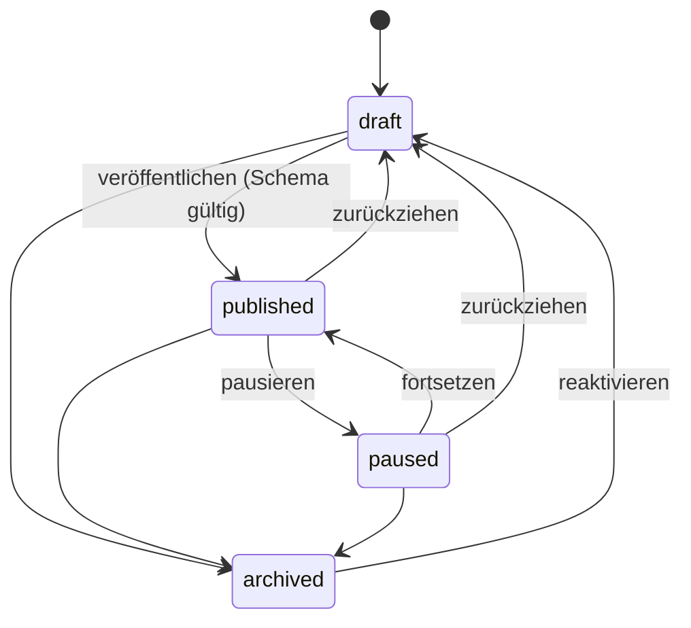
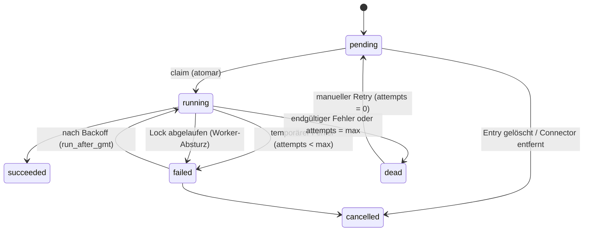

# Zustandsmodelle (P0-06)

## Formular

| Zustand | Öffentlich renderbar | Nimmt Einsendungen an |
|---|---|---|
| `draft` | nein (nur Vorschau mit Recht/Vorschau-Token) | nein |
| `published` | ja | ja |
| `paused` | zeigt `paused_message` | nein (`form_not_accepting`) |
| `archived` | Fallback-Hinweis nur für Editoren, Besucher sehen nichts | nein |

Veröffentlichen erzeugt einen neuen `fc_form_versions`-Snapshot, wenn sich der Schema-Hash geändert hat. Änderungen an einem veröffentlichten Formular werden erst mit erneutem Veröffentlichen live.

## Entry

| Von → Nach | Erlaubt | Recht |
|---|---|---|
| `new` → `read` | automatisch beim Öffnen der Detailansicht oder manuell | `form_captain_edit_entries` (Auto-Read: `read_entries`) |
| `new`/`read` → `archived` | ja | `edit_entries` |
| `archived` → `read` | ja | `edit_entries` |
| beliebig (außer `trash`) → `spam` | ja | `edit_entries` |
| `spam` → `read` („kein Spam“) | ja | `edit_entries` |
| beliebig → `trash` | ja, `previous_status` merken | `delete_entries` |
| `trash` → `previous_status` | innerhalb 30 Tagen | `delete_entries` |
| `trash` → gelöscht | manuell oder nach 30 Tagen | `delete_entries` / Cron |

Spam-Entries (automatisch erkannt) erhalten `spam_reason`; für sie werden **keine** Mails und Connector-Jobs angelegt. Wird ein Entry von `spam` auf `read` gesetzt, werden Jobs nicht nachträglich erzeugt (Admin kann Benachrichtigung manuell senden).

Jeder Wechsel feuert nach Commit `form_captain_entry_status_changed_v1( $entry_id, $old, $new )`.

## Job

- Backoff: `min(2^attempts * 60s, 6h)` + Jitter ±10 %.
- Lock: `locked_until_gmt = now + 5 min`; abgelaufene Locks werden beim nächsten Lauf als `failed` mit `lock_expired` zurückgesetzt.
- `succeeded`/`cancelled`/`dead` sind Endzustände (außer manueller Retry aus `dead`).
- Erfolgreiche Jobs werden nach 30 Tagen gelöscht, `dead` nach 90 Tagen.
