# Form Captain – Produktkonzept

**Status:** Produkt- und Umsetzungsgrundlage  
**Stand:** 15. November 2026  
**Produktname:** Form Captain  
**Repository:** hastla007/wp-formmaster  
**WordPress-Kernplugin:** form-captain  
**Premium-Add-on:** form-captain-pro  
**Lizenzserver-Produktschlüssel:** form-captain-pro (im License Captain-Katalog anzulegen)  
**Rechte-Präfix:** form.  
**Zielgruppe:** WordPress-Websites, WooCommerce-Shops, Agenturen und Nutzer der Captain Suite

> Dieses Konzept beschreibt Produktumfang und Umsetzung. Es ist keine Zusage bereits bestehender Anbieterfreigaben oder Integrationen. Externe Dienste werden nur über dokumentierte APIs angebunden; Datenschutz, Nutzungsbedingungen, Gebühren und API-Limits sind vor jeder Integration zu prüfen.

## 1. Produktidee und Positionierung

Form Captain ist ein WordPress-natives Formular- und Submission-Management-Plugin für Kontaktformulare, Anfragen, Newsletter-Anmeldungen, Registrierungen und strukturierte Geschäftsabläufe. Der Fokus liegt auf einer schnellen Bedienung, verlässlicher Speicherung und einer offenen, stabilen Schnittstelle zu WooCommerce und der Captain Suite.

**Produktversprechen:** Formulare visuell erstellen, Einsendungen sicher im eigenen WordPress verwalten und wiederkehrende Abläufe ohne individuelle Programmierung mit den Captain-Plugins verbinden.

Das Produkt besteht aus zwei getrennten Plugins:

- **Form Captain (Free):** eigenständig sinnvoll und vollständig kostenlos; veröffentlichbar auf WordPress.org. Formular-Editor, Kernfelder, Validierung, Einwilligungsfeld, E-Mail-Benachrichtigungen, Einträge, Export, Basis-Spamschutz, Gutenberg-Block und Shortcode gehören in den Kern.
- **Form Captain Pro:** separates Add-on außerhalb von WordPress.org. Es liefert professionelle Workflow-Funktionen wie mehrstufige Formulare, erweiterte Regeln, Dateien, PDFs, Zahlungs- und CRM-Anbindungen sowie Captain-Suite-Aktionen. Lizenz, Updater und Premium-Rechte liegen ausschließlich im Add-on.

Das kostenlose Plugin enthält keine Lizenzprüfung, keinen Lizenzclient, keinen eigenen Updater und keine nach Zahlung gesperrten Funktionen. Bereits im Free-Kern veröffentlichte Funktionen werden nicht nachträglich entzogen.

## 1.1 Verbindliche Produktentscheidungen für Version 1

Diese Entscheidungen gelten als Planungsgrundlage für die erste Umsetzung. Änderungen werden als bewusste Produktentscheidung dokumentiert, nicht stillschweigend während der Implementierung.

| Entscheidung | Festlegung |
|---|---|
| **Erster Zielkunde** | Kleine und mittlere deutschsprachige Unternehmen sowie WooCommerce-Betreiber, die Anfragen verlässlich erfassen und im eigenen WordPress beantworten möchten. Agenturen sind die zweite Zielgruppe. |
| **Primärer Einsatz** | Kontakt-, Angebots- und Supportanfragen. Event-, Gutschein- und Affiliate-Szenarien folgen als Suite-Adapter, nicht als Voraussetzung für ein funktionierendes Formularprodukt. |
| **Positionierung** | „Formulare und Einsendungen direkt in WordPress, mit verlässlichen Suite-Verbindungen und ohne externe Abhängigkeit für den Kernbetrieb.“ |
| **Free-Versprechen** | Unbegrenzte Formulare und Einsendungen; im Free gibt es keine künstliche Submission-Grenze, keine Pflichtregistrierung und keinen Lizenzserverkontakt. |
| **Pro-Logik** | Ein einziges eigenständiges Add-on mit vollständigem Pro-Funktionsumfang; keine Einzel-Add-ons. Pro-Tarife unterscheiden sich nur durch Site-Limit und Support. |
| **MVP v1.0** | Formulareditor, 3 Vorlagen (Kontakt, Angebot, Support), Kernfelder, einfache bedingte Feldanzeige, Einträge, E-Mail, Basisspamschutz, Export, Block/Shortcode, Datenschutzwerkzeuge und Installationsassistent. |
| **Nicht im MVP** | Zahlungen, Datei-Uploads, PDF-Erzeugung, Multi-Step, CRM-spezifische Connectoren, Abandonment, Umfragen/Quiz, öffentliche Entry-Ansichten, Multisite-Netzwerkverwaltung und KI-Formularerstellung. |
| **Erste Pro-Version** | Multi-Step, Datei-Uploads, erweiterte Bedingungen/Routing, Webhooks, PDF aus Einsendungen und Integrations-/Fehlerprotokoll. Zahlungen folgen erst nach stabiler v1.x und separater Provider-/Refund-Prüfung. |
| **Suite-Reihenfolge** | Öffentlicher Vertrag ab Free v1.0; zuerst Pass Captain (Einbettung/Event-Kontext), danach Voucher Captain (Anfrage/Firmenbestellung), anschließend Review Captain (optionale lokale Review-Übergabe) und Affiliate Captain. |
| **Unterstützungsumfang v1** | WordPress 6.8+, PHP 8.3+, WooCommerce optional ab Version 8.0; HPOS und klassischer Bestellspeicher. CI prüft zusätzlich die aktuelle stabile WordPress-Version und unterstützte PHP-Versionen. Checkout-Block-Integration ist kein MVP-Ziel. Keine Multisite-Unterstützung in v1.0. |
| **Sprachen v1** | Englisch als Quelltextsprache und de_DE/de_AT Übersetzungen; weitere Übersetzungen nach stabiler Textdomain und Übersetzungsworkflow. |

**Produktabgrenzung:** Form Captain ist zunächst kein allgemeiner No-Code-App-Builder. Keine dynamischen Datenbanken, Kundenportale oder komplexen Genehmigungsketten in v1. Diese würden Support- und Sicherheitsumfang unverhältnismäßig erhöhen.

## 2. Zielgruppen und typische Einsätze

1. **Kleine Unternehmen:** Kontakt-, Angebots-, Support- und Rückrufformulare; Einsendungen zuverlässig im WordPress-Admin nachverfolgen.
2. **WooCommerce-Händler:** Produktanfragen, Vorbestellungen, Reklamationen, individuelle Bestellwünsche und strukturierte Leads.
3. **Veranstalter:** Anmeldungen, Helfer- und Ausstellerbewerbungen sowie Ticket-/Eventanfragen.
4. **Agenturen:** Vorlagen, wiederverwendbare Formulare, Rollen und Import aus bestehenden Plugins.
5. **Captain-Suite-Nutzer:** Formulare als gemeinsamer Einstiegspunkt für Gutschein-, Ticket-, Affiliate-, Review- und Lizenzprozesse.

## 3. Wettbewerbsanalyse

Die Wettbewerber setzen unterschiedliche Schwerpunkte. Die Marktbeobachtung unten fasst die öffentlich dokumentierten Produktmerkmale zusammen (Stand 15.11.2026); Tarifgrenzen und API-Verfügbarkeit können sich ändern.

| Produkt | Stärken / öffentlich sichtbare Merkmale | Produktchance für Form Captain |
|---|---|---|
| **WPForms** | Einsteigerorientierter Drag-and-drop-Builder, Vorlagen, bedingte Logik, Benachrichtigungsrouting, Spam-Abwehr, Marketing- und Automationsintegrationen; aktuelle Feature-Seite bewirbt auch KI-gestützte Erstellung/Bearbeitung. | Fokus auf nachvollziehbare, WordPress-native Einträge und Captain-Suite-Aktionen statt primär auf möglichst viele Integrationslogos. |
| **Gravity Forms** | Robuster lizenzierter Formular-Kern, bedingte Logik, mehrseitige Formulare, Uploads, Zahlungs- und Add-on-Ökosystem, umfangreiche Entwickler-Hooks. Kein dauerhaftes WordPress.org-Free-Plugin. | Free-Einstieg und Erweiterung über öffentlichen Vertrag; Suite-Verbindungen als gepflegte, getestete Adapter. |
| **Fluent Forms** | Großzügiger Free-Umfang laut Anbieter: Drag-and-drop, bedingte Logik, Eintragsverwaltung, Vorlagen, Spam-Schutz, Export, teils Zahlungen und Integrationen; Pro erweitert unter anderem um Multi-Step, Uploads, PDFs, CRM und erweiterte Workflows. | Ein Free-Kern muss bereits den alltäglichen Kontaktformular-Use-Case sauber lösen. Differenzierung über klare Datenhaltung, Suite-Integration und einheitlichen Add-on-Vertrag. |
| **Formidable Forms** | Positioniert sich für komplexe Formulare, Berechnungen, Umfragen, Quiz, dynamische Views und aus Einträgen erzeugte Inhalte. | Keine frühe Überdehnung zum App-Builder. Erst zuverlässige Formulare/Einträge/Integrationen; Berechnungen und dynamische Ausgabe danach. |
| **Ninja Forms** | Kostenloser Kern mit einzeln kaufbaren Add-ons bzw. Paketen; Erweiterungen für Logik, mehrseitige Formulare, Zahlungen, CRM und Automationen. | Einheitliche Lizenzierung über License Captain und ein zusammenhängendes Pro-Add-on statt vieler Einzellizenzen. |
| **Contact Form 7** | Etabliertes, kostenloses und schlankes Kontaktformular mit modularer Architektur und offenem Quellcode; benötigt für viele Abläufe weitere Erweiterungen oder manuelle Konfiguration. | Modernere visuelle Erstellung und integrierte Eintragsverwaltung anbieten, ohne die Leichtgewichtigkeit und Offenheit des WordPress-Ökosystems aufzugeben. |

### Marktanforderungen und Schlussfolgerungen

- Ein intuitiver Builder, E-Mail-Benachrichtigungen, Spam-Schutz, responsive Ausgabe und einfache Einbettung gelten als Basis.
- Entry-Management, Export, Import und Migration sind kaufentscheidend, weil Formulare produktive Geschäftsdaten aufnehmen.
- Bedingte Logik, mehrseitige Formulare, Datei-Uploads, Zahlungen und Integrationen sind häufige Upgrade-Treiber.
- Ein breites Integrationsverzeichnis ist kein Ersatz für stabile, idempotente Verträge und nachvollziehbare Fehlerberichte.
- Form Captain sollte mit einem kleineren, tief integrierten und gut dokumentierten Funktionssatz starten. Keine übertriebenen „X Integrationen“-Versprechen, bevor Adapter getestet und betreibbar sind.

### Quellen (Anbieter- und WordPress-Seiten)

- [WPForms Features](https://wpforms.com/features/) und [WPForms Pricing](https://wpforms.com/pricing/)
- [Gravity Forms Features](https://www.gravityforms.com/features/) und [Gravity Forms Dokumentation: Features](https://docs.gravityforms.com/features/)
- [Fluent Forms Free vs Pro](https://fluentforms.com/free-vs-pro/) und [Fluent Forms auf WordPress.org](https://wordpress.org/plugins/fluentform/)
- [Formidable Forms Features](https://formidableforms.com/features/) und [Formidable Forms auf WordPress.org](https://wordpress.org/plugins/formidable/)
- [Ninja Forms](https://ninjaforms.com/) und [Conditional Logic Add-on](https://ninjaforms.com/extensions/conditional-logic/)
- [Contact Form 7 auf WordPress.org](https://wordpress.org/plugins/contact-form-7/)
- [WordPress.org Voraussetzungen](https://wordpress.org/about/requirements/) (PHP 8.3+ empfohlen; PHP 7.4 ist EOL).
- Preisanker: [WPForms Pricing](https://wpforms.com/pricing/), [Gravity Forms Pricing](https://www.gravityforms.com/pricing/), [Fluent Forms Pricing](https://fluentforms.com/pricing/), [Formidable Forms Pricing](https://formidableforms.com/pricing/) und [Ninja Forms Pricing](https://ninjaforms.com/pricing/).

### Preis- und Tarifbeobachtung (Stand 15.11.2026)

Die angezeigten US-Preise sind Listenpreise bzw. der auf der offiziellen Seite ausgewiesene Preis; Aktionspreise und Verlängerungsbedingungen unterscheiden sich. Die Beobachtung dient der Positionierung und ist kein direkter EUR-Preisvergleich:

| Wettbewerber | Öffentliche Jahrespreis-Anker | Lizenzstaffel / Signal |
|---|---|---|
| WPForms | Basic regulär 99 USD; Plus 199 USD; Pro 399 USD; Elite 599 USD. Die Seite bewirbt rabattierte Erstjahre und Verlängerung zum Listenpreis. | 1 / 3 / 5 / unbegrenzt Sites; Featureumfang nach Tier. |
| Gravity Forms | Basic 59 USD; Pro 159 USD; Elite 259 USD pro Jahr. | 1 / 3 / unbegrenzt Sites; Add-on-Pakete nach Tier. |
| Fluent Forms | Offizielle FAQ nennt Start ab 79 USD/Jahr; Preisseite zeigt 1 / 5 / unbegrenzt und zusätzlich Lifetime-Angebote. | Niedriger Preisanker, großzügiger Free-Tarif, umfangreiche Pro-Funktionen. |
| Formidable Forms | Listenpreise 79 / 199 / 399 / 599 USD/Jahr; Aktionen senken oft nur das erste Jahr. | Feature- und Site-Limits je Tarif; positioniert sich für komplexe/dynamische Formulare. |
| Ninja Forms | Core kostenlos; Plus/Pro/Elite Jahrespakete mit Add-ons; Preisseite nennt regulär 99 / 199 / 499 USD und rabattierte Erstjahre. | Kostenloser Kern plus einzelne Add-ons und Pakete. |

**Schlussfolgerung für Form Captain:** Die Free-Version muss echte Eintragsverwaltung, Export und einfache Logik enthalten; sonst ist der Wechselgrund schwach. Pro sollte zum Start einfacher und günstiger als die etablierten Jahrespakete sein, aber nicht als Billig- oder Lifetime-Produkt positioniert werden. Aktionen dürfen den regulären Verlängerungspreis nicht verschleiern.

### Vorgeschlagene Form-Captain-Pro-Preise zum Start

| Tarif | Jahrespreis (EUR, zzgl. USt.) | Live-Sites | Support |
|---|---:|---:|---|
| **Solo** | 49 € | 1 | Standard |
| **Studio** | 99 € | 5 | Standard |
| **Agency** | 199 € | 25 | Priorisiert |

Alle Tarife enthalten denselben Pro-Funktionsumfang, Updates und Support während der aktiven Laufzeit. Site-Limits zählen Live-Installationen; pro Live-Site ist eine Staging-Aktivierung enthalten, Development-Aktivierungen zählen nicht zum Limit, analog zum vorhandenen License Captain-Modell. Keine Lifetime-Lizenz und keine kostenpflichtigen Einzel-Add-ons zum Start. Preise nicht mit künstlichem „Normalpreis/Rabatt“-Doppelpreis vermarkten. Die Lizenz läuft 12 Monate und verlängert sich zum beim Kauf angezeigten Tarif, sofern im Checkout transparent zugestimmt wurde. Preisänderungen betreffen künftige Verlängerungen nur nach vorheriger Information und im Rahmen der Shopbedingungen.

**Begründung:** Der Einstieg liegt nahe an einem bekannten 1-Site-Preisanker, die 5-Site-Stufe deckt kleine Agenturen ab und 25 Sites bilden einen klaren Agency-Tier. Die geringere Startposition gegenüber etablierten Produkten berücksichtigt den kleineren Funktions- und Supportumfang zum Launch. Preise nach den ersten 6 Monaten anhand von Conversion, Supportkosten und Verlängerungsquote neu bewerten; bis dahin keine zusätzliche Tarifstufe einführen.

## 4. Funktionsumfang

### Verbindlicher Release-Schnitt

**Free v1.0 (WordPress.org)**

- Unbegrenzte Formulare, Felder und Einsendungen; genau die Feldarten aus Abschnitt 4.1.
- Drei direkt nutzbare Vorlagen: Kontakt, Angebotsanfrage, Support.
- Eine einfache Feldregel je Feldgruppe: anzeigen/ausblenden anhand eines Feldwerts. Keine verschachtelten Gruppen und keine bedingten Aktionen.
- Einträge mit Status neu/gelesen/archiviert/Spam; Suche, Datums-/Formularfilter, Detailseite und CSV-Export.
- Admin-Mail, optionales Nutzer-Receipt und eine Abschlussmeldung oder URL-Weiterleitung.
- Honeypot, Mindestzeit und zeitbasiertes Rate-Limit; kein externer Captcha-Dienst standardmäßig.
- Gutenberg-Block und Shortcode; kein Formular-Hosting außerhalb der Installation.
- Privacy Exporter/Eraser, Aufbewahrungsoption, Consent-Feld und ausdrückliche Bestätigung externer Dienste.
- Öffentlicher Contract v1 mit Events und Dokumentation; in v1.0 noch keine Suite-Automation, aber keine inkompatible private Schnittstelle.

**Pro v1 (separates Add-on)**

- Mehrseitige Formulare mit Fortschritt und Fortsetzen-Link.
- Datei-Upload mit Allowlist, Größenlimit, geschützten Downloads und automatischer Löschung.
- Verschachtelte AND/OR-Bedingungen und bedingte Bestätigungen/Benachrichtigungsziele.
- Webhook-Aktionen mit Feldzuordnung, Signatur, Idempotenz, Retries und Protokoll.
- PDF-Generierung aus Entry-Vorlage.
- Lizenz-/Updater-Seite und Updatefeed nach License Captain Vertrag.

**Nach v1.0, in dieser Reihenfolge**

1. Contact Form 7-Formularimport mit Konvertierungsbericht; Entry-Import nur, wenn eine kompatible Exportquelle vorliegt.
2. Pass Captain-Adapter: Eventformular aus Eventseite einbetten, Event-ID als verifizierbarer Kontext, keine automatische Ticket-/Bestellausstellung.
3. Voucher Captain-Adapter für Gutscheinanfrage/Firmenbestellung nach expliziter Prüfung und Bestätigung.
4. Affiliate- und Review-Adapter.
5. CRM-Connectoren; Zahlungen nur nach stabiler Webhook-/Idempotenzbasis und eigener Provider-/Refund-Spezifikation.
6. Weitere Migrationen, Analytics, White-Label und Multisite nur nach Nutzungsdaten/Nachfrage.

**Wichtig für die Konkurrenzfähigkeit:** Einfache bedingte Anzeige wird in Free geliefert, weil sie bei starken kostenlosen Wettbewerbern Teil des Basispakets ist. Die bezahlte Abgrenzung liegt bei komplexen Regeln und Aktionen statt bei einer künstlichen Sperre der einfachsten Logik.

### 4.1 Form Captain Free – Kernumfang

**Erstellen und Veröffentlichen**

- Formularübersicht mit Entwurf, veröffentlicht, pausiert, Einsendungen und Datum der letzten Änderung.
- Visueller Formular-Editor mit Feldliste, Feldreihenfolge, Einstellungen, Vorschau und Speichern.
- Feldtypen zum Start: einzeiliger Text, Absatz, E-Mail, Telefon, Zahl, Auswahl, Checkbox, Optionsfeld, Datum, Überschrift/HTML-Hinweis, versteckter Wert und Einwilligung.
- Pro Feld: Bezeichnung, interner Schlüssel, Pflichtstatus, Standardwert, Hilfetext, Platzhalter, Zeichen-/Wertegrenzen und CSS-Klasse.
- Kernvalidierung serverseitig; Browser-Validierung ist zusätzliche Bedienhilfe.
- Gutenberg-Block mit Formularauswahl und Vorschau; Shortcode als kompatibler Fallback. Responsives Markup, Theme-erbliche Farben und keine zwingende externe Skript-/Font-Ladung.
- Versandbestätigung: Erfolgsmeldung oder Redirect auf eine ausgewählte Seite.

**Benachrichtigungen und Einträge**

- Admin-Benachrichtigung mit Empfänger, Antwortadresse, Betreff und Feldzuordnung.
- Optional eine Bestätigung an die einsendende Person; Absenderdomäne und Fehlerhinweis im Admin prüfen.
- Einträge persistent in eigenen Tabellen speichern, mit Suche, Filtern, Detailansicht, Status (neu, gelesen, archiviert, Spam), Notiz und Papierkorb.
- CSV-Export mit Spaltenauswahl, Datumsfilter und korrekter Behandlung von Formelzeichen; Export nur mit Capability und Nonce.
- Einträge standardmäßig auf der Website halten; kein Versand an Drittanbieter ohne konfigurierte Integration und transparente Einwilligung.

**Missbrauchsschutz, Rechte und Datenschutz**

- Honeypot, Mindest-Ausfüllzeit, Rate-Limit je IP-Hash/Formular und einfacher Wort-/E-Mail-Blocklist-Filter. Keine rohe IP länger speichern als für den Zweck nötig.
- Captcha-Provider sind optional und explizit zu aktivieren; deren Datentransfer und Datenschutzhinweis werden dokumentiert.
- WordPress-Privacy-Exporter/Eraser, Retentionsregel, Datenexport und Löschbarkeit je Formular; optionale Aufbewahrungsfrist.
- Rollen und Capabilities: Formulare verwalten, Einträge lesen, Einträge exportieren, Einstellungen ändern. Standard: Administrator kann alles; Editor erhält keine sensiblen Einträge ohne Zuweisung.
- Nonces, Capability-Prüfung, Escaping, Sanitizing, sichere Upload-Verzeichnisse (sobald Upload verfügbar), Schutz vor CSRF/XSS/SQL-Injection und Rate-Limit auf Submission-Routen.
- Übersetzungsfertig, Deutsch als Startsprache, Textdomain form-captain.

**Basisbetrieb**

- Setup-Checkliste, Beispiel-Kontaktformular, Systemstatus und verständliche Fehlerhinweise.
- Formulare als JSON importieren/exportieren; keine Entries im Formular-Export.
- Entwickler-Hooks und versionierte öffentliche API von Anfang an vorsehen.

### 4.2 Form Captain Pro – Add-on-Roadmap

Der folgende Funktionskatalog beschreibt die mittelfristige Pro-Roadmap. **Verbindlich für den ersten Verkauf ist ausschließlich „Pro v1“ im Release-Schnitt oben.** Zahlungsfunktion, direkte CRM-Connectoren und White-Label sind keine Launch-Zusagen.

| Bereich | Pro-Funktionen |
|---|---|
| **Form Builder** | Mehrspaltige Layouts, wiederverwendbare Feldgruppen, erweiterte Feldtypen (Datei, Signatur, Bewertung, Adresse), bedingte Felder und Abschnitte, Multi-Step-Formulare mit Fortschritt, mehr Regeln für Bestätigung und Benachrichtigungsrouting. |
| **Workflows** | Bedingte Aktionen und Benachrichtigungen, Einträge zuweisen, interne Aufgaben/Status, geplante Formulare und Submission Limits, Webhooks mit Feldmapping, Wiederholungswarteschlange und Ausführungsprotokoll. |
| **Dateien und Dokumente** | Sichere Datei-Uploads mit Typ-/Größenlimit, private Speicherung außerhalb des öffentlichen Verzeichnisses soweit möglich, Ablauf/Löschung, PDF aus Entry mit Vorlage und Anhängen; niemals unsicher ausführbare Dateitypen zulassen. |
| **Daten und Ausgabe** | Berechnungen, Umfragen/Quiz mit Basisreport, PDF/CSV-Export, Entry-Ansicht im Frontend nur für freigegebene Scopes, Entry-to-Post mit expliziter Feldzuordnung und moderiertem Status. |
| **Zahlungen** | Gebühren/Spenden und Bestell-/Registrierungsbeträge über offizielle Zahlungsprovider-APIs; Provider-Webhook-Verifikation, Idempotenzschlüssel, Refund-/Fehlerstatus. Keine Kartendaten im WordPress speichern. MVP erst nach eigenständiger Zahlungs- und Compliance-Prüfung. |
| **Integrationen** | CRM-/Newsletter-Connectoren, Zapier/Make/n8n via Webhook oder dokumentiertem Adapter; Integrationsstatus, Testverbindung, Feldzuordnung und Fehlerjournal. |
| **Betrieb** | Entry-Abandonment/Partial Entries, Versionshistorie und Wiederherstellung, erweiterter Export/Import und unterstützte Migrationen; Agentur-/White-Label-Option erst nach Nachfragevalidierung. |

**Pro-Schnitt:** Der Free-Kern bleibt für einfache Formulare dauerhaft brauchbar. Pro monetarisiert Automatisierung, komplexe Workflows und aufwendige Betriebsfunktionen. Kernformulare, die im Free erstellt wurden, bleiben auch ohne Pro unverändert nutzbar; Pro-Daten bleiben gespeichert und werden nach Lizenzende nicht gelöscht. Die Aktivierung folgt dem gemeinsamen Add-on-Kernel: Feature-Rechte werden aus dem signierten Lizenzstatus gelesen, täglich geprüft und bis zu 14 Tage offline zwischengespeichert; nur autorisierte Pro-Features registrieren schreibende Aktionen. Bei fehlendem Recht bleiben Free-Formulare und Einträge intakt, Pro-Editor-/Workflow-Aktionen pausieren mit erklärendem Admin-Hinweis und Pro-Updates stehen nicht zur Verfügung.

## 5. Captain-Suite-Integration

### Leitprinzip

Form Captain bleibt ein eigenständiges Formularprodukt. Jedes Suite-Plugin integriert sich über versionierte öffentliche Funktionen, Aktionen oder Adapter. Kein Plugin liest oder verändert direkt die Tabellen eines anderen Plugins. Connectoren prüfen Plugin-Version und Vertragsversion und zeigen inkompatible Zustände sichtbar an.

### Gemeinsame technische Verträge

- Öffentliche Funktion/API mit Major-Version, Capability-Checks und dokumentierten Fehlercodes.
- Aktionen nach erfolgreichem Commit (z. B. Formular abgeschickt, Entry erstellt, Entry geändert, Entry gelöscht) mit minimalem Payload.
- Filter/Aktionsregistrierung für Felder, Formularaktionen, Admin-Menü, Eintragsdetails, Bestätigungslinks und Export.
- Idempotency-Key für externe/geschäftskritische Aktionen; Wiederholungen erzeugen keine doppelten Gutscheine, Tickets, Provisionen oder API-Ereignisse.
- Keine vollständigen Bestell-, Zahlungs- oder unnötigen Personendaten in Suite-Events; nur IDs und explizit freigegebene Feldwerte.
- Integrationsdiagnose: erkanntes Plugin, Version, Vertragskompatibilität, letzte Ausführung, Fehler und erneuter Versuch.

### Vertrag v1 – feste Namenskonvention und Mindestereignisse

Der Kern definiert in v1 folgende öffentliche, stabile Namensfamilie; Ereignisse feuern erst nach erfolgreichem Datenbank-Commit:

- Versionskonstante: FORM_CAPTAIN_CONTRACT_VERSION = 1.0.0.
- Aktionen: form_captain_form_created_v1, form_captain_form_updated_v1, form_captain_entry_created_v1, form_captain_entry_status_changed_v1 und form_captain_entry_deleted_v1.
- Admin-Menü: form_captain_admin_menu_built_v1($parent_slug), damit Pro und Suite-Adapter ihre Seiten als Unterseiten ergänzen können.
- Öffentliche Read-API: form_captain_get_form_v1($form_id), form_captain_get_entry_v1($entry_id, $scopes) und form_captain_submit_v1($form_id, $payload, $context).
- Erweiterungspunkt für Adapter: form_captain_register_action_v1($key, $definition, $callback) registriert eine Formularaktion mit Version, Einstellungsfeldern, Mapping/Validierung und Callback. Sie darf erst nach form_captain_loaded_v1 registriert werden. Beim Senden erhält der Callback nur die vom Administrator zugeordneten, validierten Werte plus form_id, entry_id und idempotency_key; keine vollständige Submission außerhalb des Scopes.
- Ergebnisobjekt: success, code, form_id/entry_id und request_id; erwartete Validierungs-/Berechtigungsfehler werden als Ergebnis zurückgegeben.
- Ein Adapter registriert sich erst nach form_captain_loaded_v1 und prüft die kompatible Vertrags-Major-Version. Inkompatible Major-Versionen werden deaktiviert und mit Code incompatible_contract in der Diagnose angezeigt.
- Entry-Ereignisse liefern standardmäßig IDs, Form-ID, Zeitstempel und eine Allowlist explizit freigegebener Werte; keine vollständigen WordPress- oder WooCommerce-Objekte, Zahlungsdaten oder rohe IP-Adresse.
- Jede schreibende Integration verlangt serverseitige Berechtigung und Idempotency-Key. Externe Fehler ändern keinen bereits gespeicherten Entry; sie erzeugen einen wiederholbaren Integrationsjob.

### Konkrete Integrationen

| Plugin | Möglicher Nutzen | Form Captain Vertrag / Schutz |
|---|---|---|
| **License Captain** | Pro-Aktivierung, Rechteprüfung, signierte Offline-Rechte und Pro-Updates. | Nur form-captain-pro verwendet den vorhandenen PHP License Client und Produktschlüssel form-captain-pro. Kern bleibt lizenzfrei; Lizenzseite wird unter Form Captain eingehängt. Feature-Rechte z. B. form.uploads, form.workflows, form.payments. |
| **Pass Captain** | Anmelde-/Bewerbungsformulare für Events, Anmeldedaten als Ausgang für Registrierung oder Ticketverkauf, Formlink auf Eventseiten. | Pass Captain ruft eine öffentliche Form-Captain-Funktion zum Einbetten/Ermitteln eines Formulars auf oder erhält eine freigegebene Submission-Referenz. Ticket-Erstellung nur als explizite Aktion in Pass Captain Pro/Kernvertrag; keine stillschweigende Ausstellung aufgrund einer Formularantwort. |
| **Voucher Captain** | Gutschein-Anfragen, Firmenbestellungen und Geschenkpersonalisierung. | Öffentliche Voucher-Ausstellungs-/Firmenbestell-API verwenden. Beträge, Empfänger und Einwilligung klar zuordnen; kein direkter Gutschein-Tabellenzugriff. Gutschein wird nur nach expliziter Bestätigung und optionaler Zahlung ausgestellt. |
| **Affiliate Captain** | Partnerbewerbungen, Kontaktdaten und manuell freigegebene Anmeldungen; Referral-/Affiliate-Code als Formularfeld. | Affiliate-Vertrag zur Partneranlage/Statusänderung nutzen, falls vorhanden; keine automatische Freigabe ohne Administratorentscheidung. Referral-Code als attributiertes Feld übergeben, keine Trackingdaten ohne Zustimmung. |
| **Review Captain** | Optional Form-Captain-Formulare als Eingabeoberfläche für lokale Reviews nutzen. | Review Captain Pro registriert eine Formularaktion „Review zur Moderation übergeben“ und übergibt explizit zugeordnete Felder an die Review-Captain-API. Review Captain besitzt Review, Herkunft, Moderation und Veröffentlichung; Form Captain besitzt Formular und Einsendung. Nicht verifizierte Formantworten werden nie als Kauf-/Teilnahme-verifiziert markiert. Formulareinsendungen lösen keine Review-Einladung aus. |
| **WooCommerce** | Produktanfragen, Reklamation, Angebotsanfrage, Checkout-/Bestellbezug und Zahlung. | Optionaler Adapter über WooCommerce CRUD/Hook APIs (HPOS und Blocks berücksichtigen). IDs statt serialisierter Bestellobjekte übergeben; Zahlungsauslösung nur mit serverseitig validiertem, idempotentem Payment-Provider. |

### Festgelegte Form-Captain-Brücke

- **Keine gegenseitige Pflichtabhängigkeit:** beide Free-Plugins funktionieren einzeln. Der Review-Adapter ist ein späterer Suite-Ausbau; er benötigt Form Captain Core und Review Captain Pro mit aktivem Entitlement review.suite_integrations. Form Captain Pro ist für den einfachen Übergang nicht nötig.
- **Datenbesitz:** Form Captain bleibt System of Record für Formular, vollständige Einsendung und deren Aufbewahrung. Review Captain ist System of Record für die daraus erzeugte lokale Review, Moderationsstatus und öffentliche Anzeige. Es gibt keine direkten Tabellenzugriffe.
- **Explizite Aktion statt stiller Automatik:** ein Administrator ordnet im Formular ein Zahlen-, Options- oder Auswahlfeld mit zulässigen Werten 1–5 als Sternebewertung sowie Reviewtext und optionalen Anzeigenamen zu; für v1 ist kein neues Feld nötig und aktiviert „Review Captain: lokale Review zur Moderation anlegen“. Eine gültige Einsendung erzeugt nur einen wartenden Review; es gibt keine automatische Veröffentlichung oder Anfragen-E-Mail.
- **Herkunft:** Review-Datensatz speichert source_plugin=form-captain und source_entry_id. Der Idempotency-Key lautet form-captain:{site_id}:{entry_id}; Wiederholungen erzeugen keine Review-Duplikate.
- **Verifizierungsstatus:** Formulareingaben sind standardmäßig „nicht verifiziert“. Ein Nutzerfeld oder versteckter Wert kann niemals Kauf/Teilnahme nachweisen. Nur ein vertrauenswürdiger Commerce-/Event-Vertrag darf verifiziert, kaufbestätigt oder teilnahmebestätigt setzen.
- **Löschung:** wird die Quell-Einsendung gelöscht, entfernt Review Captain den Verweis und löscht standardmäßig die noch wartende, daraus erzeugte Review. Freigegebene Reviews werden über die Review-Captain-Privacy- und Moderationsregel entfernt/anonymisiert; dies wird in beiden Admins nachvollziehbar angezeigt.
- **Einladungen:** Review Captain plant öffentliche Plattform-Anfragen nur aus vertrauenswürdigen, vom Quell-Plugin bestätigten Erlebnisereignissen mit experience_id, Kontaktresolver und Versandberechtigung. form_captain_entry_created_v1 allein ist dafür kein zulässiger Trigger.
- **Einführungszeitpunkt:** nicht Teil von Free v1.0. Erst nach stabilen Form-Captain- und Review-Captain-Core-Verträgen bauen und Ende-zu-Ende testen.

### Integrationsausbau in Stufen

1. **MVP:** Gutenberg/Shortcode, WooCommerce-Kontext als versteckter signierter Referenzwert, Ereignis-Hooks und Developer-Dokumentation.
2. **Erste Suite-Adapter:** Pass Captain und Voucher Captain für Einbettung/Anfragen; klare Aktionen im Form-Editor; keine automatische Geschäftsaktion ohne Review.
3. **Review Captain:** optionale Formularaktion für lokale Reviews in Review-Captain-Moderation; Review-Anfragen weiterhin ausschließlich über vertrauenswürdige Experience-Events. Danach Affiliate-Adapter.
4. **Externe Dienste:** Webhooks als generische Grundlage; spezifische CRM-/Payment-Connectoren jeweils nach Nachfrage und API-Prüfung.

### Kundenspezifische Projekt-Connectoren

Form Captain unterstützt zusätzlich **separate Connector-Plugins für kundenspezifische Projekte**. So kann ein Kunde Formulare mit einem eigenen Kurs-, Buchungs-, CRM-, Mitglieder- oder Verwaltungsprojekt verbinden, ohne Form Captain Core zu forken oder projektspezifische Datenmodelle in den Kern aufzunehmen.

#### Muster aus den bestehenden Captain-Plugins

| Vorbild | Bereits gelöstes Muster | Übernahme für Form Captain |
|---|---|---|
| [Pass Captain – Erweiterungen](https://github.com/hastla007/wp-passmaster/blob/main/docs/EXTENSIONS.md) | Versioniertes ConnectorInterface, Registry-Filter, ausdrückliche site-lokale Aktivierung sowie wiederholbare Hintergrundjobs mit Backoff und Dead-letter. | Form Captain erhält eine stabile Registry, opt-in je Website und Formularaktion sowie eine gemeinsame Jobverarbeitung. |
| [Voucher Captain – Connector-Leitfaden](https://github.com/hastla007/wp-couponmaster/blob/main/CONNECTORS.md) | Der Kern bleibt fachlich generisch; der separate Connector besitzt die externe Leistung. Der Leitfaden enthält einen ausführbaren Beispiel-Connector, definierte Idempotenz, Fehler-/Refund-Verhalten und Integrationstests. | Projektspezifische Geschäftslogik und Zielsystem-Zustand gehören in das separate Connector-Plugin; Beispielimplementierung und Release-Checkliste werden mitgeliefert. |
| [Affiliate Captain – Integrationsvertrag](https://github.com/hastla007/wpaffiliatemaster/blob/main/docs/CONTRACT.md) | Versionierte öffentliche API, additive Änderungen innerhalb einer Hauptversion, Idempotenz und klare Verantwortung der Verkaufsquelle; kein Tabellenzugriff. | Form Captain dokumentiert jede öffentliche Schnittstelle, hält v1 abwärtskompatibel und bietet Scopes statt direktem Datenbankzugriff. |

#### Verbindliche Architektur

- **Connector ist ein eigenes WordPress-Plugin.** Es wird separat installiert und kann für einen einzelnen Kunden geschrieben oder als wiederverwendbare Branchenintegration angeboten werden. Form Captain Core enthält keine kundenspezifische Kurs-, Mitglieder-, ERP- oder CRM-Logik.
- **Zuständigkeit:** Form Captain besitzt Formular, Schema, vollständige Einsendung, Eintragsstatus und Aufbewahrung. Der Connector besitzt Feldmapping, projektspezifische Regeln, Zugangsdaten zum Zielsystem, Remote-IDs, Rückabwicklung und den Zustand der externen Leistung.
- **Versionierter Connector-Vertrag:** Für v1 wird ein PHP-Interface im Namespace `FormCaptain\Integrations` mit stabilem Connector-Key, Vertragsversion, deklarierten Fähigkeiten/Aktionen und einem Handler für benannte Aktionen, minimierte Payloads und Idempotency-Key vorgesehen. Connectoren registrieren sich über den öffentlichen Registry-Filter `form_captain_connectors_v1`; benutzerseitige Formularaktionen werden über `form_captain_register_action_v1` beschrieben.
- **Kompatibilität:** v1 bleibt innerhalb der Major-Version additiv. Für inkompatible Hauptversionen wird der Connector deaktiviert und der Zustand im Admin erklärt. Nicht dokumentierte Klassen, Datenbanktabellen und interne Hooks gelten nicht als API.
- **Opt-in:** Neue Connectoren sind nach Installation standardmäßig deaktiviert. Ein Administrator aktiviert den Connector site-lokal und wählt pro Formular ausdrücklich erlaubte Aktionen. Die Integrationsseite zeigt Plugin-/Vertragsversion, Anforderungen, Fähigkeiten und letzten Status.
- **Feldfreigabe:** Der Administrator ordnet nur validierte Formularfelder und nötige IDs zu. Sensible Felder sind standardmäßig ausgeschlossen. Der Handler bekommt keine vollständige Submission, außer ein gesonderter, begründeter Scope wurde freigegeben.
- **Ausführung:** Der Entry wird zuerst gespeichert. Danach stellt die Outbox die Connectoraktion asynchron zu. Ein stabiler Schlüssel je Site, Entry, Connector und Aktion macht Wiederholungen idempotent. Temporäre Fehler erhalten Backoff; nach standardmäßig acht Versuchen landet der Job im Dead-letter-Status und kann nach Diagnose manuell erneut gestartet werden.
- **Fehlergrenze:** Ein Connector-Ausfall blockiert weder Formularannahme noch Entry-Verwaltung oder native Form-Captain-Mail. Connectoren liefern strukturierte Ergebnisse und wiederholbare/nicht wiederholbare Fehler zurück; externe Änderungen und Kompensationen bleiben Aufgabe des Connectors.
- **Löschen und Deaktivieren:** Abschalten oder Entfernen eines Connectors löscht keine Formulare/Entries. Offene Jobs werden sichtbar pausiert oder gemäß dokumentierter Richtlinie beendet. Entry-Löschung und Consent-Widerruf lösen nur die zuvor vertraglich konfigurierten Bereinigungsereignisse aus; keine ungefragte Löschung im Fremdsystem.
- **Lizenzierung:** Der allgemeine Connector-Vertrag, die Registry und die sichere Aktionsausführung sind im Free-Kern verfügbar. Form-Captain-Pro-Rechte gelten nur für Premiumfunktionen wie komplexe Workflows, Webhooks, Uploads oder PDFs. Ein kundenspezifischer Connector darf einfache Form-Captain-Aktionen nicht künstlich von Form Pro abhängig machen.
- **Abgrenzung zu Webhooks:** Ein Webhook sendet ein generisches HTTP-Payload. Ein Connector-Plugin bildet einen fachlichen Prozess ab – inklusive API-Version, Zielzustand, Berechtigungen, Fehlerbehandlung, Wiederholung, Rückabwicklung und Admin-Einstellungen. Beliebiger PHP-Code wird niemals im Formular-Editor eingegeben.

#### Ein Connector wird so entwickelt und betrieben

1. Zielprojekt, Datenbesitz, erlaubte Aktionen, Rückabwicklung und Datenschutzumfang definieren.
2. Connector-Plugin prüft, ob Form Captain und eine kompatible Vertragsversion verfügbar sind.
3. Connector deklariert Aktionen, Einstellungsfelder, Voraussetzungen und benötigte Feld-Scopes.
4. Website-Administrator aktiviert ihn ausdrücklich und ordnet pro Formular die freigegebenen Felder zu.
5. Nach erfolgreicher Entry-Speicherung wird die Aktion mit stabilem Idempotency-Key in die Queue gestellt.
6. Connector verarbeitet die Aktion im Zielsystem und meldet Erfolg, temporären Fehler oder endgültigen Fehler zurück.
7. Integrationsseite zeigt Lauf, Retry/Dead-letter, Testmodus und nächste mögliche Aktion.
8. Contract- und Zwei-Plugin-Tests prüfen Wiederholung, Ausfall, Deaktivierung, Löschung und API-Inkompatibilität.

Ein Referenz-Connector im Form-Captain-Repository demonstriert Registrierung, Freigabe, Feldzuordnung, idempotente Verarbeitung und Retry gegen einen lokalen Beispieldienst. Er ist Muster und Testfixture, keine produktionsreife Anbindung an ein reales Kundensystem.

#### Pilot-Connectoren für zwei konkrete Interessenten

Die folgenden Vorschläge sind anhand der jeweiligen Repositories abgegrenzt. Sie sind technische Konzepte und noch keine bereits implementierten oder vom Kunden bestätigten Integrationen.

| Interessent | Vorgeschlagener Connector | Einsatzort und Richtung | Machbarkeit |
|---|---|---|---|
| **BoatingSchool – B2B-Plattform** | Separates Plugin **Form Captain – BoatingSchool Leads** | Auf einer WordPress-Marketing- oder Shop-Website mit Form Captain; serverseitig von WordPress an einen neuen Lead-Endpunkt der Laravel-Plattform. | **Machbar nach Plattform-Erweiterung.** Die dokumentierte Commerce-API dient Shopkonten, Bestellpositionen und Kurscodes. Ein Lead-/Interessenten-Endpunkt ist darin nicht dokumentiert und darf nicht durch `/accounts` oder Bestellendpunkte ersetzt werden. |
| **LearnBoating – B2C-Lernplattform** | Separates Plugin **Form Captain – LearnBoating Connector** | Auf derselben WordPress-Installation wie `bootspruefung-learning`; lokal über dokumentierte WordPress-Erweiterungspunkte, ohne externen API-Aufruf. | **Als Kursfrage-Integration machbar.** Der Lernplugin-Vertrag beschreibt Gutscheine, Tickets und Praxis-Angebote, aber keine Formular-/Supportfälle. Für verifizierten Kurskontext braucht es einen kleinen öffentlichen Erweiterungsvertrag im Lernplugin. |

##### A. BoatingSchool: B2B-Demo- und Schulzugangsanfrage

**Zweck:** Interessenten aus Bootsschulen können eine Demo, ein Beratungsgespräch oder Informationen zum B2B-Angebot anfragen. Form Captain bleibt auf einer WordPress-Seite der Einstieg und speichert die vollständige Einsendung. Der neue Connector übermittelt nur die ausdrücklich freigegebenen Lead-Felder an BoatingSchool.

**Benötigte Erweiterung in BoatingSchool:** eine eigene, signierte Lead-Intake-API, beispielsweise `POST /api/integrations/v1/form-captain/leads`, plus eine tenant-unabhängige Lead-Inbox im Superadmin. Diese API und Inbox sind neu zu spezifizieren; die vorhandene `/api/commerce/v1`-API ist kein Lead-CRM. Leads bleiben unqualifizierte Interessenten und werden weder automatisch zu Schulen/Tenants noch zu App-Konten oder Shopkonten. Erst der bestehende, getrennte Prüf- und Freigabeprozess darf ein Konto bzw. eine Schule anlegen.

**Erlaubte Minimaldaten:** Schul-/Organisationsname, Kontaktname, geschäftliche E-Mail, optional Telefon, Land/Region, gewünschter Gesprächstyp, grobe Größenklasse und freigegebene Nachricht. Formular-ID, Entry-ID, Quell-URL und Einwilligungs-/Datenschutzhinweis werden als Herkunfts- und Nachweisreferenz mitgeführt. Feldfreigabe erfolgt pro Formular; Freitext und optionale Felder sind standardmäßig aus.

**Sicherheits- und Betriebsvertrag:** HTTPS und serverseitige HMAC-Signatur mit Zeitstempel/Nonce, Replay-Schutz und eigener rotierbarer Connector-Zugangsdaten; den bestehenden Commerce-Schlüssel nicht wiederverwenden. Ein `Idempotency-Key` aus WordPress-Site, Formular und Entry verhindert doppelte Leads. Die Plattform prüft Schema und Rate-Limits und liefert eine stabile Lead-ID zurück. WordPress speichert diese Remote-ID und den Zustellstatus; Secrets bleiben in `wp-config.php` bzw. geschützter Serverkonfiguration und gelangen nie in Browser, Formfelder, Logs oder E-Mails. Temporäre Fehler werden über die Form-Captain-Outbox mit Backoff wiederholt; definitive Validierungsfehler werden angezeigt und sind nicht automatisch wiederholbar.

**Admin-Ablauf:** Form-Captain-Administrator aktiviert den Connector, hinterlegt Endpoint und Zugangsdaten, führt einen Verbindungstest ohne echten Lead aus, wählt die Aktion „B2B-Lead an BoatingSchool senden“ und ordnet Felder zu. Die Integrationsseite zeigt Lead-ID, letzten Versuch, Status und sichere Fehlerbeschreibung. Die Superadmin-Inbox in BoatingSchool übernimmt Qualifizierung, Kontaktaufnahme, Ablehnung oder getrennte Konto-/Schulfreigabe.

**Bewusste Grenzen:** Kein Anlegen oder Verknüpfen eines Shopkontos, keiner Schule, eines Tenants oder Lernenden; keine automatische Einladung oder Bestellung; keine Übertragung von Passwörtern, Lernständen, Prüfungsdaten oder Codes. Existiert noch kein Lead-Endpunkt, bleibt die Einsendung in Form Captain und wird über dessen normale, konfigurierte Benachrichtigung bearbeitet. Direkter Datenbankzugriff und ein Workaround über bestehende Commerce-Endpunkte sind ausgeschlossen.

##### B. LearnBoating: Kursfrage mit geprüftem Kurskontext

**Zweck:** Auf Kurs-, Produkt- oder Lerninformationsseiten kann eine Besucherin eine Frage zum passenden Bootsschein-Kurs stellen. Form Captain speichert den Entry und verschickt die normale, vom Websitebetreiber konfigurierte Benachrichtigung. Der Connector ergänzt den vom Lernplugin bestätigten Kurskontext und zeigt im Form-Captain-Admin eine verlässliche Kursreferenz.

**Benötigter öffentlicher Erweiterungspunkt:** Das Lernplugin veröffentlicht einen dokumentierten, versionierten Kurskontext-Vertrag (Vorschlag: `bootspruefung_form_context_v1`) mit nur den öffentlichen Angaben `course_code`, `label`, `permalink` und `status`. Der Connector kann den Kontext serverseitig aus der aktuellen Seite beziehen oder eine Kursauswahl gegen diese Liste validieren. Er liest weder interne Tabellen noch private Klassen und vertraut keinem vom Browser gesetzten versteckten Kurscode. Bei fehlendem oder inkompatiblem Vertrag wird die Aktion deaktiviert und der normale Form-Captain-Entry bleibt möglich.

**V1-Aktion und Datenfluss:** „Kursfrage mit Kurskontext“ ist eine lokale Form-Captain-Aktion. Sie verknüpft Entry-ID, Kurscode, Kurslabel und Herkunftsseite; Kontaktfelder gehen nur dann in eine optionale Benachrichtigung, wenn Websitebetreiber sie ausdrücklich zuordnen. Vorhandene WordPress-Kontaktdaten dürfen nur nach expliziter Besucherentscheidung vorausgefüllt werden. Lernfortschritt, Prüfungsversuche, Bestellungen, Gutscheinwerte und Nutzerprofile werden nicht ausgelesen oder übertragen.

**Zielsystem und Grenze:** Da kein Support-Ticket-/Fall-API im dokumentierten LearnBoating-Vertrag beschrieben ist, wird V1 nicht als Ticketanlage oder Synchronisierung in eine Lernplugin-Inbox beworben. Der Form-Captain-Entry ist die maßgebliche Anfrage; LearnBoating liefert nur validierten Kurskontext. Eine spätere Übergabe an ein Supportsystem erfordert einen eigenen öffentlichen Vertrag samt Verantwortlichkeit, Statusmodell, Idempotenz und Löschregeln.

**Ausdrücklich ausgeschlossen:** amtliche Prüfungsanmeldung oder Terminvergabe, Praxisstunden/-tickets, Bootsschul-B2B-Prozesse, Lernzugang, Gutscheine, Affiliate-Attribution, WooCommerce-Bestellung/-Zahlung und automatische Nutzeranlage. Gutschein- und Affiliate-Abläufe bleiben bei den bereits vorhandenen LearnBoating-Connectoren.

##### Gemeinsame Lizenz- und Freigaberegel

Beide Connectoren sind eigenständige Plugins mit eigener Versionsnummer, Installations-/Supportgrenze und dokumentiertem Datenumfang. Der stabile Form-Captain-Connector-Vertrag und einfache Aktionen sind im Free-Kern verwendbar; Form Captain Pro wird nur für tatsächlich benötigte Pro-Funktionen wie komplexe Bedingungen oder Premium-Workflows verlangt. Eine kommerzielle Lizenz für einen kundenspezifischen BoatingSchool-Connector wird separat mit dem Kunden festgelegt und kann – falls das Plugin wiederverwendbar verkauft wird – als eigenes Produkt über License Captain lizenziert werden. Sie darf nicht implizit mit einer Form-Captain-Pro-Lizenz gleichgesetzt werden.

**Kompatibilitätsbasis für LearnBoating:** Der dokumentierte Stand des Lernplugins nennt WordPress 7.0+, PHP 8.1+ und WooCommerce 11.2+. Zusammen mit Form Captain gilt daher mindestens WordPress 7.0+ und PHP 8.3+; WooCommerce wird nur vorausgesetzt, soweit die installierte LearnBoating-Version selbst es benötigt. Vor Implementierung sind diese Anforderungen am dann aktuellen Release zu verifizieren.

## 6. Admin-Seiten und Frontend-Seiten

| Seite | Aufgabe und Inhalt |
|---|---|
| **Dashboard** | Setup-Status; Anzahl aktiver Formulare und neue Einsendungen; letzte Formulare; Systemhinweise; Schnellaktionen „Formular erstellen“, „Einträge ansehen“, „Seite erstellen“. Keine globalen störenden Upgrade-Banner. |
| **Formulare** | Tabelle mit Name, Status, Einbettungscode/Block-Hinweis, Einträge, Änderungsdatum; Suche/Filter; Aktionen Bearbeiten, Duplizieren, Vorschau, Export, Pausieren, Löschen. |
| **Formular erstellen / Editor** | Vorlagenauswahl (Kontakt, Anfrage, Newsletter, Eventanmeldung); Feldpalette; Canvas; Feld-Einstellungen; Formular- und Benachrichtigungseinstellungen; Vorschau Desktop/Mobil; Veröffentlichung. |
| **Einträge** | Tabelle mit Formular, Datum, Status, Name/E-Mail soweit vorhanden; Filter, Suche, Bulk-Aktionen, Export. Rollen und Capabilities müssen vor Abfrage greifen. |
| **Eintragsdetail** | Antwortwerte, Quelle/Formular, Zeitstempel, Status, interne Notiz, Spamgrund, Lösch-/Exportaktion. Keine vollständigen IP-Adressen oder unnötigen Browser-Fingerprints. |
| **Integrationen** | Suite-Adapter und separate kundenspezifische Connector-Plugins mit Erkennung, Vertragsversion, ausdrücklicher Aktivierung, Anforderungen/Fähigkeiten, Formularaktions-Auswahl, Feld-Scopes, Testmodus, Queue-/Dead-letter-Status und Fehlerdiagnose. Pro-Verbindungen klar mit Lizenzstatus versehen. |
| **Einstellungen** | Allgemein, Absender/SMTP-Hinweis, Datenschutz/Aufbewahrung, Spamschutz, Eintragsrechte, Import/Export, Systemstatus und Entwickler-API. |
| **Formular-Frontend** | Form mit Labeln, Pflichtfeld-Hinweisen, Inline-Fehlern, Erfolgsmeldung, Tastaturbedienung, Screenreader-Ansagen und responsivem Layout. |
| **Optionale Systemseiten** | Erfolg-/Danke-Seite per WordPress-Seitenauswahl; keine ungefragt angelegten öffentlichen Seiten. Pro: Fortsetzen-Link, Upload-Bestätigung, Zahlungsstatus. |

### Inhalt der Ersteinrichtung

1. Formularzweck auswählen; ein importierbares Beispiel wird erstellt.
2. Empfängeradresse und Absender prüfen.
3. Formular auf einer bestehenden oder neu gewählten Seite einsetzen (Gutenberg-Block/Shortcode).
4. Testeinsendung auslösen und Admin-Eintrag/E-Mail-Status zeigen.
5. Datenschutz- und Retention-Einstellungen wählen.
6. Suite-Plugins optional erkennen und Adapter später aktivieren.

## 7. Datenmodell und technische Leitplanken

**v1-Datenmodell (Entscheidung):** Tabellen mit WordPress-Präfix für Formulare, Entries und Entry-Werte; keine WordPress-Post-Zeile pro Antwort. Formulare haben numerische interne ID, öffentliche zufällige Kennung, Status, schema_version und ein validiertes JSON-Schema. Entries speichern Form-ID, Status, UTC-Zeitstempel, Lösch-/Retention-Datum und minimale Quellenmetadaten. Werte sind zeilenweise über entry_id + field_id abgelegt, damit CSV- und Privacy-Export gezielt möglich ist. Sensible Feldwerte werden nicht in Debug- oder Integrationslogs kopiert. Schemaänderungen erhalten versionierte Migrationen; Form-JSON-Import nimmt niemals Einsendungen oder Uploads ungefragt mit. Neue Installationen verwenden standardmäßig eine Aufbewahrungsfrist von 12 Monaten; bei der Einrichtung kann der Betreiber 90 Tage, 12 Monate oder manuelle Löschung wählen. Vor Ablauf werden keine Einsendungen automatisch ohne Admin-Hinweis gelöscht; gelöschte Einträge werden endgültig bereinigt, einschließlich referenzierter Dateien.

- Formulardefinition versioniert als JSON-Schema mit stabilen Feld-IDs; Einreichungen werden tabellarisch in eigener Entry-Tabelle gespeichert, Antwortwerte strukturiert und schema-versioniert. Keine Einsendungen als WordPress-Post pro Submission.
- Entry und Datei-Referenzen getrennt; private Dateiablage und Lösch-/Ablaufjobs für Uploads.
- Submission-Service zentralisiert: Sanitizing, Validierung, Rate-Limit, Speicherung, E-Mail/Workflow-Queue und Integrationsereignisse in definierter Reihenfolge.
- Externe Aktionen asynchron ausführen können, mit Idempotenz, Retry-Limits, Dead-letter-/Fehlerstatus und Admin-Protokoll. Kernsubmission darf durch ausgefallene CRM-/Webhook-Dienste nicht verloren gehen.
- REST-Routen mit WordPress-Nonce für Admin und geeigneter öffentlicher Token-/Rate-Limit-Strategie für Einreichung; öffentliche Submit-Routen erlauben nur definierte Operationen.
- HPOS-kompatibler Woo-Adapter; keine Abhängigkeit von WooCommerce für das Kernplugin.
- Multisite: Daten pro Site, Netzwerkaktivierung mit klarer Datenmigration und Capabilities; Entscheidung vor MVP festlegen.
- Uninstall löscht Formulare/Einträge nur nach expliziter Admin-Auswahl und dokumentierter Bestätigung.
- PHP-/WordPress-Mindestversion: WP 6.8+ und PHP 8.3+; CI-Matrix muss zusätzlich gegen aktuelle stabile Versionen laufen.

**WordPress.org-Platzierung:** Die Trennung folgt den aktuellen Plugin-Richtlinien: Trialware/Funktionssperren im WordPress.org-Free-Plugin sind nicht zulässig; die Richtlinien empfehlen ausdrücklich ein außerhalb des Verzeichnisses angebotenes Add-on für Premiumcode. Lizenzprüfung, Premium-Updater und Pro-Code bleiben daher ausschließlich in form-captain-pro. Upgrade-Hinweise bleiben kontextbezogen, sparsam und wegklickbar. Quelle: [Detailed Plugin Guidelines (Developer.WordPress.org)](https://developer.wordpress.org/plugins/wordpress-org/detailed-plugin-guidelines/).

## 8. Lizenzierung und Verkauf

Die Lizenzierung folgt dem bestehenden Captain-Suite-Modell:

1. **Form Captain Free** wird als eigenständiges GPL-Kernplugin auf WordPress.org angeboten.
2. **Form Captain Pro** wird als privates Add-on in hastla007/captain-pro geführt; Slug, Add-on-Ordner, Textdomain und Produktschlüssel: form-captain-pro.
3. Der Lizenzserver ist License Captain (hastla007/wp-license). Dort wird das Produkt mit Laufzeit, Site-Limit, Support-Level und Entitlements konfiguriert.
4. Pro-Add-on vendort den Lizenzclient in eigenem Namespace. Der Add-on-Kernel prüft Kernplugin-Version, verbindet die Lizenzseite unter Form Captain und startet Features nur bei passenden Rechten.
5. Der Updater validiert signierte Metadaten sowie Paketgröße und SHA-256. Lizenzstatus und Offline-Cache folgen dem bestehenden Client-Vertrag.
6. Ablauf/Deaktivierung der Lizenz stoppt nur Pro-Aktionen/Updates gemäß Vertrag. Free-Formulare und bestehende Einträge bleiben erhalten.
7. Die empfohlenen Starttarife stehen im Abschnitt „Vorgeschlagene Form-Captain-Pro-Preise zum Start“; die drei Jahrespläne erhalten Site-Limits 1/5/25. Feature-Entitlements sind über alle Tarife identisch. Zahlungs-, Widerrufs- und Verlängerungstexte werden vor Verkauf für die Zielmärkte geprüft.

## 9. Umsetzungsplan und To-do

Die vollständige Umsetzungsliste wurde in [TODO.md](TODO.md) übernommen und um den Workflow-Captain-Provider ergänzt. Die Phasen, Abnahmekriterien und fachlichen Grenzen sind dort die operative Aufgabenliste; dieses Konzept bleibt Produkt- und Architekturgrundlage.

## 10. Risiken und Entscheidungen vor Produktionsstart

- **E-Mail-Zustellung:** WordPress wp_mail() allein garantiert keine Zustellung. SMTP-Anleitung, Absenderprüfung und nachvollziehbarer Versandstatus bereitstellen.
- **Personenbezogene Daten:** Formulare können sensible Daten sammeln. Minimierung, Rollen, Retention, Export/Löschung und externe Datenübertragung klar steuern.
- **Upload-Risiko:** Dateitypen, Malware-Prüfung/Serverlimits, Zugriffsschutz, Speicherort und Bereinigung vor Veröffentlichung festlegen.
- **Zahlungen:** PCI-/Provider-Anforderungen, Webhook-Sicherheit, Rückerstattungen und Doppelbuchungen vor dem Zahlungsfeature prüfen.
- **Plugin-Überladung:** MVP auf Formularbau, Einträge, Spam-Schutz und verlässliche Benachrichtigung begrenzen.
- **Kompatibilität:** WooCommerce Checkout Blocks und HPOS, Caching, Multisite und Pagebuilder früh in der Supportmatrix berücksichtigen.
- **WordPress.org-Regeln:** Free-Kern frei nutzbar halten; Premiumcode und dessen eigener Updater im separaten Add-on.
- **Integrationswartung:** Keine Suite-Integration nur über nicht versionierte interne Klassen. Vertragstests und Deprecation-Policy sind Voraussetzung.

## 11. Erfolgskriterien

- Neuer Nutzer kann das Beispiel-Kontaktformular ohne Dokumentation veröffentlichen und erfolgreich testen.
- Eine Formularantwort geht nicht verloren, wenn Mail oder externe Integration ausfällt.
- Einträge sind nur für berechtigte Rollen sichtbar und können datenschutzkonform exportiert/löschen werden.
- Das Frontend lädt keine nicht benötigten Drittanbieterressourcen und ist per Tastatur verwendbar.
- Jede Suite-Aktion ist nachvollziehbar, wiederholbar und idempotent.
- Free ist ohne Lizenz verwendbar; Pro-Funktion und Update sind nach Lizenzserver-Vertrag überprüfbar.
- Migrationen erhalten Feldzuordnungen und Entry-Daten, soweit die Quellformate dies ermöglichen.
## Quellen und Referenzen

- [Review Captain – Produktkonzept und Suite-Vertrag](https://github.com/hastla007/wp-reviewmaster/blob/main/konzept.md)

## Suite-Abgleich mit den gebauten Plugins (15.11.2026)

| Verbindung | Vorhandene Grundlage | Noch zu bauen / verbindliche Grenze |
|---|---|---|
| Pass Captain | Öffentliche Services und versionierte Voucher-/Check-in-Provider sind im Konzept und in der Hook-Dokumentation beschrieben. | Formularauswahl/Einbettung im Event-Admin und ein eigener Form-Captain-Adapter fehlen. Ein Formularentry darf keine Buchung oder Ticket-Ausstellung auslösen. |
| Voucher Captain | Versionierte PHP-API, externe Einlösung und Connector-Verträge sind vorhanden. | Anfrage-/Personalisierungsadapter fehlt. Erst nach ausdrücklicher Prüfung über Voucher-Service ausstellen; keine direkte Tabellenmanipulation. |
| Affiliate Captain | Öffentlicher Verkaufs-/Partnervertrag v1.3 mit Status `pending` ist vorhanden. | Eine Formular-zu-Partner-Anlage ist nicht im Vertrag. Vor einer Erweiterung den bestehenden Bewerbungsablauf bevorzugen; keine stillschweigende Freigabe oder Provisionsanlage. |
| Review Captain | Konzept definiert optionales Formular-Action-Mapping und lokale Review-Übergabe. | Noch nicht implementiert. Benötigt Review Captain Pro, explizite Feldzuordnung, idempotente Quelle, pending/unverified und Löschweitergabe. Keine Einladungs-E-Mail aus Form-Einsendungen. |
| License Captain / Captain Pro | Bestehendes Add-on-/License-Client-Modell ist etabliert. | Form Captain Pro ist geplant; Produktschlüssel, Entitlements, Admin-Einbindung und Lizenzkatalog müssen vor Premium-Release mit den bestehenden Add-ons abgeglichen werden. |

Für die Implementierung sind die genannten Verträge versionsgenau zu prüfen. Bestehende APIs/Hooks werden nur gemäß ihrer dokumentierten Semantik verwendet; ein im Konzept benannter zukünftiger Hook ist bis zur Implementierung kein vorhandener Vertrag.

## 12. Ablaufdiagramme: Form Captain und Captain Suite

### 12.1 Formular erstellen und Einsendung verarbeiten

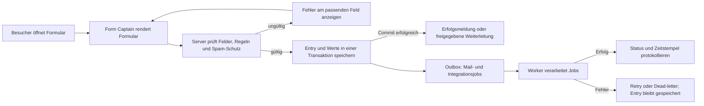

**Verbindliche Reihenfolge:** Erst Eingaben validieren, dann Entry dauerhaft speichern, danach E-Mail und Adapterjobs ausführen. Mail- oder API-Ausfälle dürfen keine gespeicherte Einsendung zurückrollen. Fehlerausgaben an Besucher enthalten keine internen SQL-, Server- oder Providerdetails.

### 12.2 Free, Pro und Lizenzprüfung

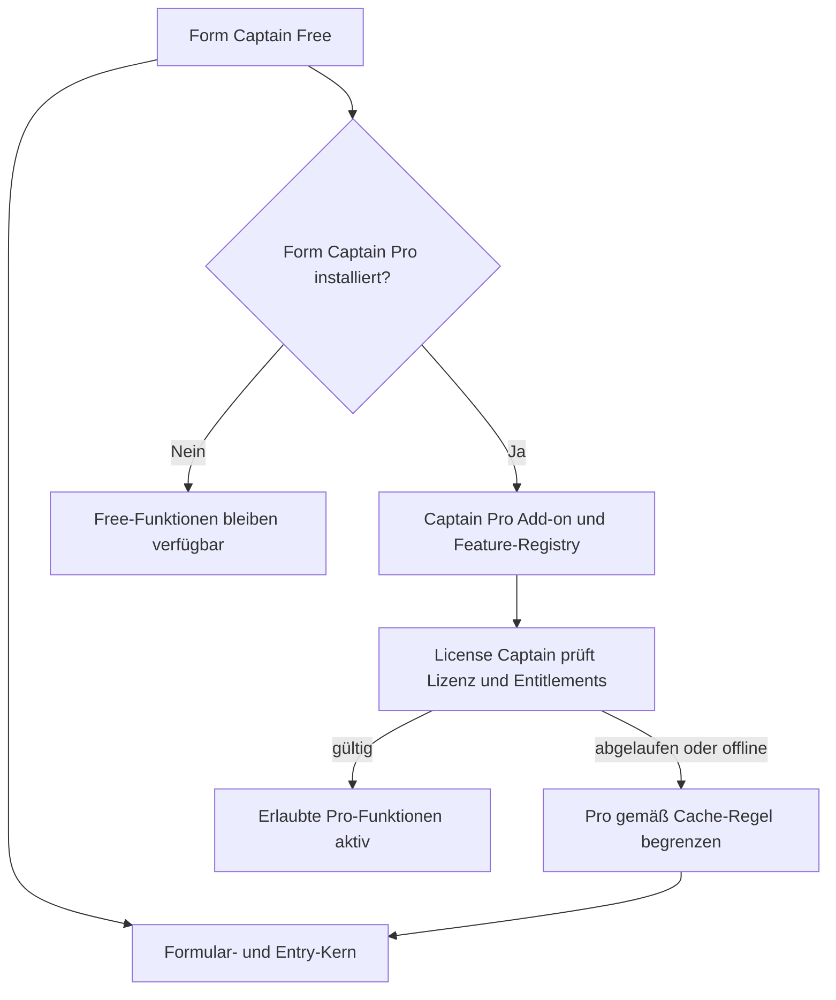

Form Captain Free bleibt ohne Lizenzserver nutzbar. License Captain verwaltet Lizenzstatus, Site-Limits und Updates; Captain Pro enthält den Premiumcode. Lizenzverlust darf Free-Formulare und bestehende Einsendungen nicht löschen.

### 12.3 Captain-Suite-Verbindungen und Datenbesitz

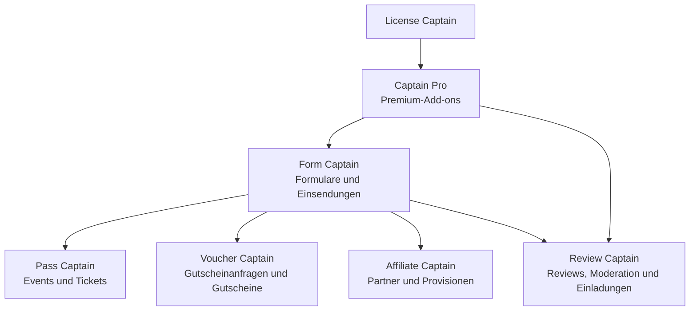

Die Verbindungen sind optionale Adapter über dokumentierte Verträge. Sie öffnen keine fremden Tabellen. Form Captain verwaltet Formular und vollständige Einsendung. Das jeweilige Zielplugin bleibt Eigentümer seines Geschäftsdatensatzes. License Captain und Captain Pro betreffen nur Pro-Lizenzierung und Premiumcode.

### 12.4 Freigabepflichtige Formularaktionen

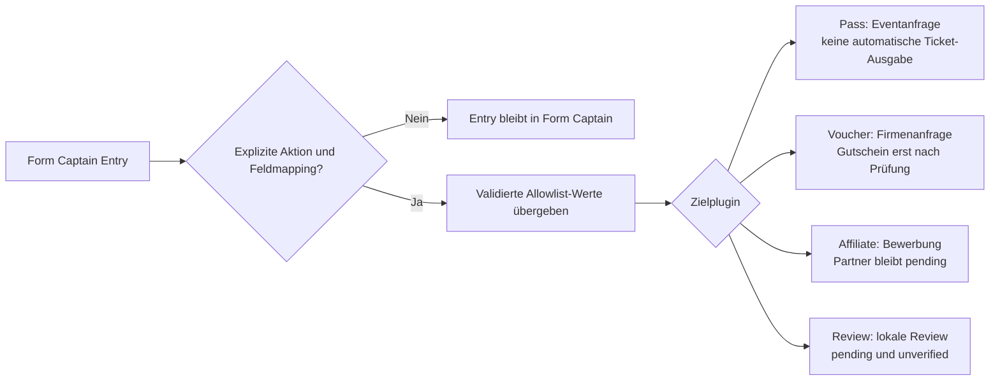

Ein verstecktes Formularfeld beweist weder Zahlung noch Teilnahme. Die Review-Übergabe erzeugt keine öffentliche Review-Einladung. Jede Aktion benötigt Idempotenz, Diagnose und eine definierte Löschweitergabe.

### 12.5 Review-Einladungen nach bestätigtem Erlebnis

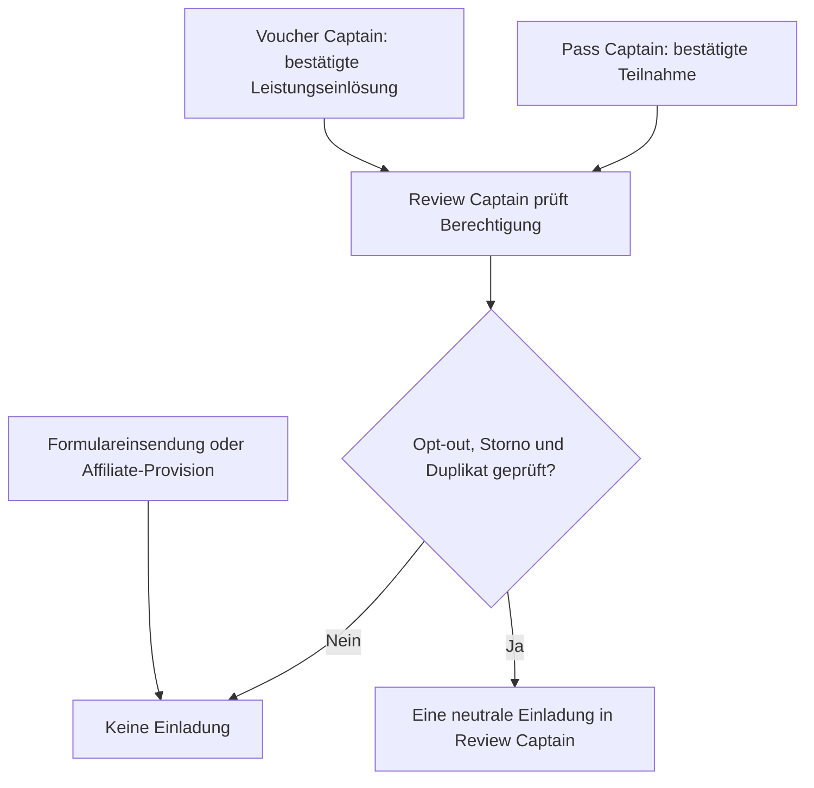

Ein Ticketkauf, eine Gutscheinausgabe, eine allgemeine Einlösung, ein Formulareintrag oder eine Provision ist allein kein zulässiger Auslöser. Quellplugin, Erlebnisreferenz, Kontaktauflösung, Versandberechtigung und deduplizierter Status müssen vertraglich feststehen.

### 12.6 Verkauf und Affiliate-Zuordnung

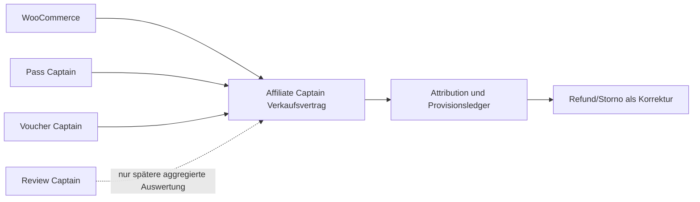

Provisionsberechnung verwendet die bestehenden Verkaufsquellenverträge und Idempotenzregeln. Reviews ändern keine Provision. Eine spätere Review-Auswertung darf nur freigegebene Aggregate enthalten, keine Einzelreviews oder Käuferdaten.

### 12.7 Kundenspezifischer Projekt-Connector

¤¤¤mermaid
flowchart LR
    A["Connector-Plugin installiert"] --> B["Version und Voraussetzungen prüfen"]
    B --> C["Admin aktiviert Connector"]
    C --> D["Aktion und erlaubte Felder zuordnen"]
    D --> E["Form Captain speichert Entry"]
    E --> F["Idempotenter Job in Outbox"]
    F --> G["Connector verarbeitet Zielprojekt"]
    G -->|Erfolg| H["Ergebnis protokolliert"]
    G -->|temporärer Fehler| I["Retry mit Backoff"]
    I -->|nach acht Versuchen| J["Dead-letter und Admin-Diagnose"]
¤¤¤

Der Connector ist standardmäßig deaktiviert. Sein Ausfall beeinträchtigt die gespeicherte Einsendung und Form-Captain-Kernfunktionen nicht.

### 12.8 Kundenabläufe: BoatingSchool und LearnBoating

**BoatingSchool – neue Interessentenanfrage:** Form Captain nimmt den Entry zuerst an und speichert ihn. Der separate Connector stellt danach idempotent einen minimierten Lead an eine neue, signierte Laravel-API zu. Die Plattform legt einen Lead in einer tenant-unabhängigen Superadmin-Inbox an. Qualifizierung und eine mögliche Schul-/Kontofreigabe bleiben ein manueller, getrennter Prozess. Solange API und Inbox fehlen, bleibt die Anfrage in Form Captain.

**LearnBoating – Kursfrage:** Das Lernplugin stellt über einen öffentlichen Vertrag den Kurskontext der Seite bereit. Form Captain speichert die Frage als Entry und verknüpft den validierten Kurscode. Es erfolgt keine Ticket- oder Prüfungsbuchung. Bei fehlender Erweiterungsschnittstelle kann die Einsendung weiterhin ohne Kursaktion verarbeitet werden.

| Schritt | BoatingSchool B2B | LearnBoating B2C |
|---|---|---|
| 1. Auslöser | Demo-/Schulzugangsformular auf WordPress | Kursfrage auf Kurs-/Produktseite |
| 2. Kontext | Explizite Lead-Felder und Einwilligung | Kurscode/Label serverseitig aus öffentlichem Lernplugin-Vertrag |
| 3. Speicherung | Vollständiger Entry in Form Captain | Vollständiger Entry in Form Captain |
| 4. Integration | Asynchroner, signierter API-Aufruf zur neuen Lead-Inbox | Lokale Kurskontext-Aktion; keine externe Übertragung |
| 5. Ergebnis | Lead-ID und Status für Admin; Qualifizierung in BoatingSchool | Kursreferenz am Entry; normale Form-Captain-Benachrichtigung |
| 6. Grenze | Keine Konto-/Tenant-/Schulanlage oder Commerce-Funktion | Keine Prüfung, Termin-, Ticket-, Gutschein-, Affiliate- oder Lernzugangsaktion |

## 13. UI-Mockups: Konzeptansichten der Seiten

Die folgenden SVGs sind **illustrative Mockups des geplanten Produkts**, keine Screenshots einer bereits installierten oder implementierten Anwendung. Beispielnamen, Zahlen und Lizenzstatus sind Platzhalter. Die Integrationskacheln stellen Verfügbarkeit bzw. Planungsstatus dar, keine aktive Verbindung.

### 13.1 Dashboard und Einrichtung

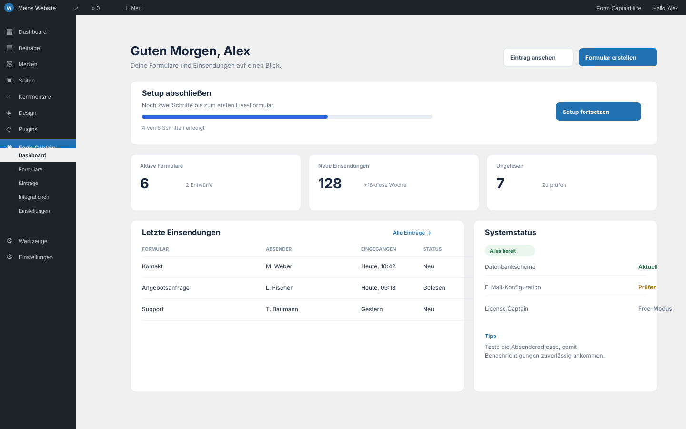

### 13.2 Formularübersicht

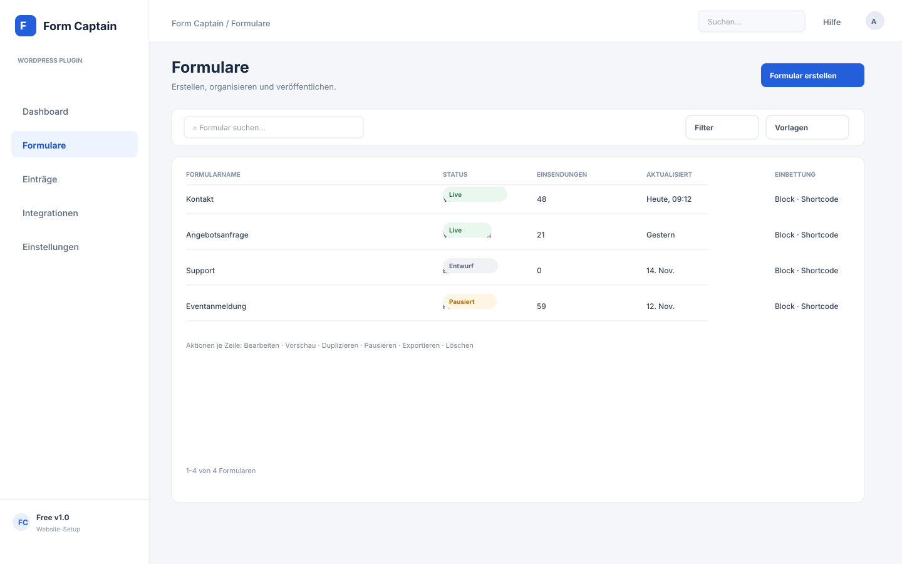

### 13.3 Formular-Editor

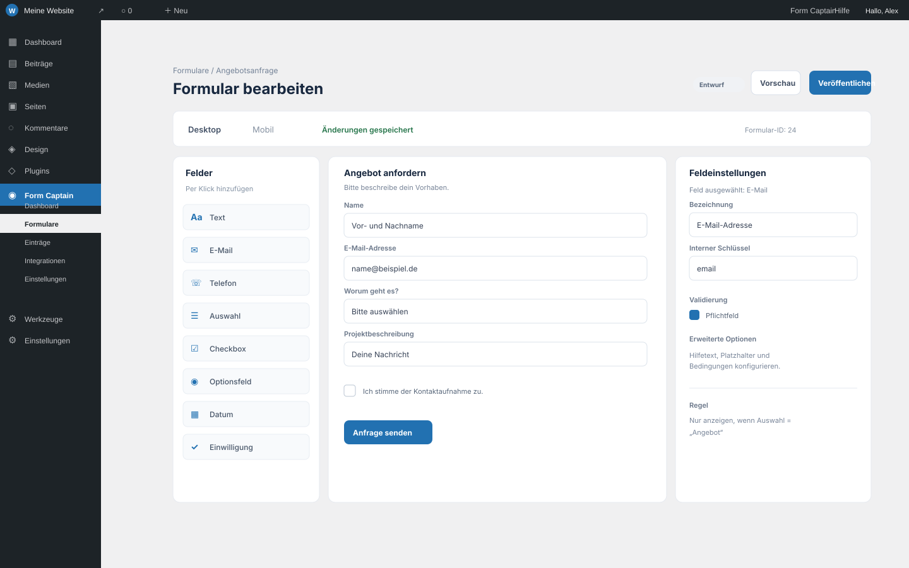

### 13.4 Einsendungen verwalten

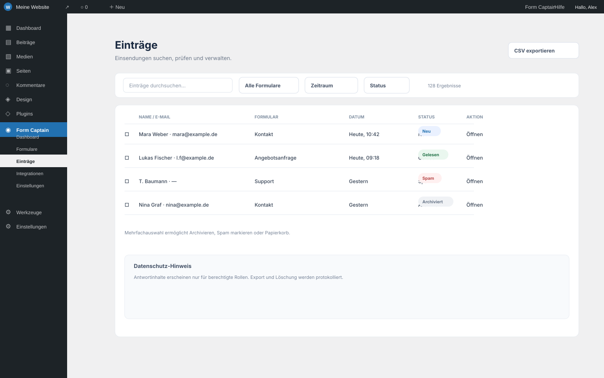

### 13.5 Integrationen der Captain Suite

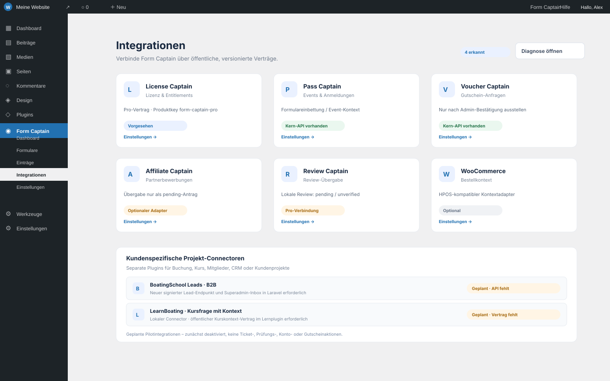

### 13.6 Datenschutz, E-Mail und Pro-Lizenz

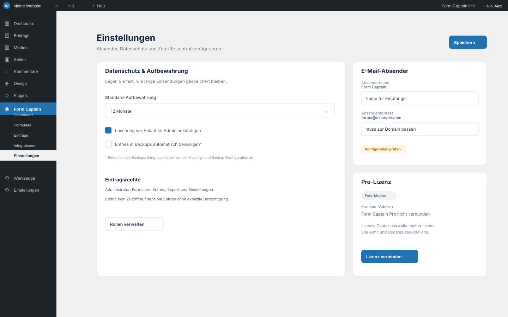

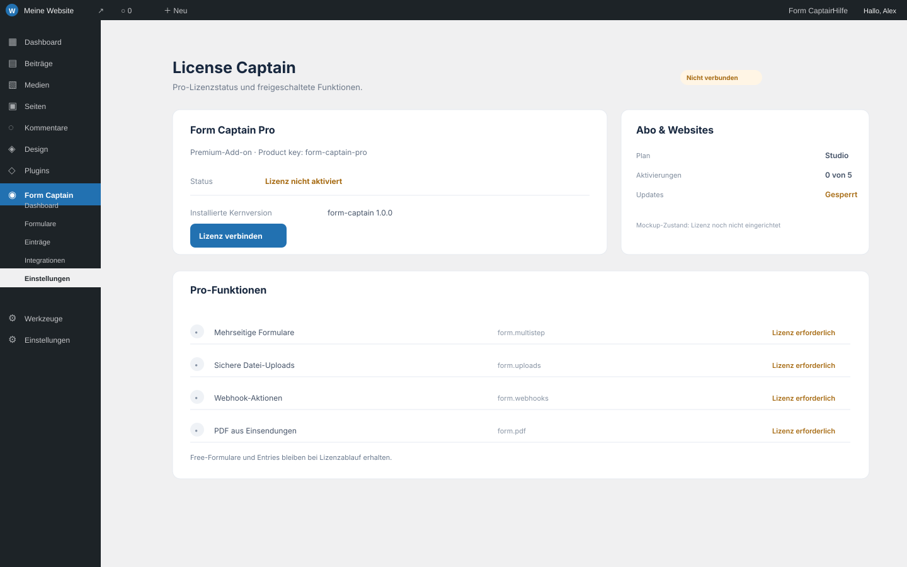

### 13.7 Öffentliches Formular

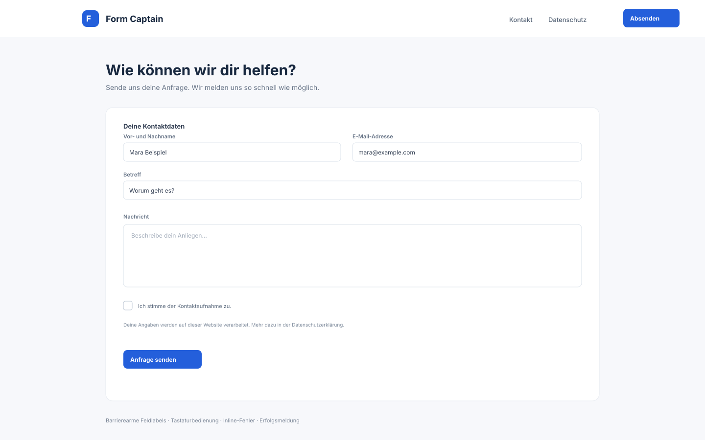

### 13.8 Gestaltungs- und Umsetzungsregeln

- Die Admin-Oberfläche orientiert sich an WordPress, verwendet klare Statusfarben und zeigt Rechte-/Fehlerzustände direkt am betroffenen Objekt.
- Seiten müssen leere, ladende, erfolgreiche, fehlerhafte und nicht berechtigte Zustände erhalten; die Mockups zeigen überwiegend den Normalzustand.
- Der Editor muss auf Desktop und Tablet funktionieren. Feldlabels, Fehlermeldungen, Fokuszustände und Status sind nicht allein durch Farbe zu vermitteln.
- Frontend-Formulare erben Theme-Stile kontrolliert; der Block-/Shortcode-Output lädt keine unnötigen Drittanbieterressourcen.
- In den Integrationsansichten sind „vorhandene Kern-API“, „geplanter Adapter“, „Pro-Verbindung“ und „nicht verbunden“ deutlich unterschiedliche Zustände.
- Vor Implementierung der Oberfläche werden diese Ansichten in echte WordPress-Seiten, leere Zustände, Berechtigungsfälle und responsive Varianten übersetzt.
